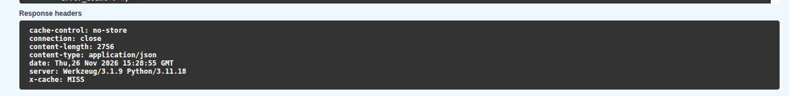
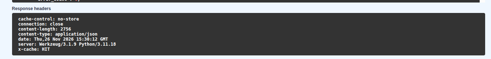

# SCRUM-24 — Cache Redis des KPI

## Rôle et périmètre

Le cache concerne la réponse complète de GET /api/v1/stats :
cartes de synthèse, indicateurs SaaS, période effective et date de calcul.

Lorsqu’une entrée valide existe, l’application la réutilise sans
interroger Elasticsearch ni MongoDB.

Lorsqu’elle est absente, expirée ou illisible, l’application recalcule
depuis les sources. Seules les réponses HTTP 200 valides peuvent
être enregistrées.

Une indisponibilité Redis en lecture ou en écriture n’empêche pas
le retour des résultats calculés depuis les sources.

## Stockage et types

- Base logique Redis : 0.
- Préfixe : loganalyzer:stats:v2:
- Clé : préfixe suivi d’une empreinte SHA-256.
- Type Redis : string.
- Encodage de la valeur : JSON UTF-8.
- Contenu : clé, date d’expiration et réponse complète des KPI.
- Taille maximale acceptée par entrée : 1 048 576 octets.

Une réponse dépassant cette taille reste disponible depuis les sources,
mais n’est pas enregistrée en cache.

Le préfixe v1 représente la version du contrat.
Il doit évoluer si une modification des calculs rend les anciennes
réponses incompatibles.

## Construction des clés

L’empreinte est calculée sur un objet JSON canonique :
clés triées, encodage UTF-8 et séparateurs stables.

| Élément | Raison |
|---|---|
| Début et fin explicites normalisés en UTC | Séparer les périodes tout en réunissant les dates équivalentes |
| Mode de début implicite : 24h-before-end | Permettre la réutilisation des périodes relatives |
| Mode de fin implicite : now | Permettre la réutilisation des périodes allant jusqu’à maintenant |
| Service et organisation | Isoler les filtres |
| Fuseau Africa/Tunis et jour local courant | Séparer les cartes journalières au changement de jour |
| Seuil SQL | Séparer les configurations métier |
| TTL configuré | Séparer les configurations de conservation |
| Adresse Elasticsearch et motif des index | Identifier la source des logs |
| Hôte, port et base MongoDB | Identifier la source du suivi des imports |

Les paramètres sont validés avant la consultation du cache.
Les espaces de bord des filtres sont supprimés.
Des dates équivalentes exprimées en UTC ou avec un décalage produisent
la même clé pour une même période explicite.

## Durée de vie

Variable : STATS_CACHE_TTL_SECONDS.

| Valeur | Comportement |
|---|---|
| Absente | 60 secondes |
| 0 | Cache désactivé |
| 1 à 3600 | Durée maximale en secondes |
| Hors limites ou non entière | Configuration refusée au démarrage |

La durée est mesurée depuis generated_at, début du calcul.
Le temps passé à calculer réduit donc la durée restante en cache.

L’expiration est fixée au plus tôt entre :

- generated_at + TTL ;
- le prochain minuit dans Africa/Tunis.

La valeur et son expiration absolue sont écrites ensemble avec SET PXAT.
Une lecture HIT ne renouvelle pas le TTL.

Une réponse dont le calcul a traversé un changement de journée
n’est pas enregistrée sous la clé de l’ancienne journée.

## Périodes glissantes et fraîcheur

Pour les 24 dernières heures, les bornes effectives sont celles du
calcul initial, conservées pendant la durée de validité du cache.

Sur un HIT, les champs filters et generated_at sont conservés.
L’application ne modifie pas la date de calcul pour faire paraître
la réponse plus récente.

La même règle s’applique à un début explicite avec une fin implicite
à maintenant.

Les périodes explicites sont également mises en cache : les documents
et le suivi des imports peuvent évoluer après leur calcul.

Aucune invalidation immédiate n’est déclenchée après un import.
Un nouvel événement ou un nouveau fichier peut donc apparaître dans
les KPI seulement après expiration et nouvelle consultation.

Le TTL limite la réutilisation côté serveur.
Une page laissée ouverte conserve son affichage jusqu’à une nouvelle
actualisation ; elle ne se recharge pas automatiquement.

## Comportement des réponses

| En-tête X-Cache | Signification |
|---|---|
| HIT | Réponse valide réutilisée depuis Redis |
| MISS | Cache non réutilisé ; calcul exécuté depuis les sources |
| BYPASS | Cache désactivé ou Redis indisponible ; route exécutée depuis les sources |

MISS ne garantit pas une écriture en cache : une réponse trop volumineuse,
un calcul trop long ou un passage à minuit peuvent empêcher son stockage.

Cache-Control: no-store reste présent pour empêcher le navigateur ou
un intermédiaire HTTP de conserver sa propre copie.
Le cache Redis est géré séparément, côté application.

Une entrée valide peut être servie pendant son TTL même si une source
est devenue indisponible depuis son calcul.

Si aucun cache valide n’est disponible et qu’une source échoue,
la route conserve la réponse HTTP 503 STATS_UNAVAILABLE.
Les réponses en erreur ne sont jamais mises en cache.

## Configuration et exploitation

REDIS_HOST et REDIS_PORT définissent la connexion interne.
Les délais de connexion et de commande sont chacun fixés à 0,3 seconde.

STATS_CACHE_TTL_SECONDS est transmis au service webapp par Docker Compose.
La valeur peut être définie dans le fichier .env.
Après modification, recréer webapp pour appliquer sa nouvelle configuration.

Redis contient des données reconstructibles.
Une perte de son contenu entraîne de nouveaux calculs.

La limite de taille par entrée ne limite pas la mémoire totale de Redis.
La configuration actuelle ne définit pas de plafond global maxmemory.

Deux requêtes simultanées sur une entrée absente peuvent toutes deux
effectuer le calcul. Aucun verrou de calcul partagé n’est implémenté.

## Validations réalisées

[Bilan des vérifications](validation-cache/bilan-cache.json)

- MISS suivi d’un HIT avec réponse identique.
- Aucun nouvel accès Elasticsearch ou MongoDB sur HIT.
- Réutilisation pour des dates équivalentes dans des fuseaux différents.
- Isolation de deux services avec des résultats différents.
- Vérification du type Redis string et du TTL.
- Recalcul après une entrée illisible.
- Expiration réelle avec un TTL de test de deux secondes.
- Calcul depuis les sources lorsque la lecture Redis échoue.
- Conservation du résultat lorsque l’écriture Redis échoue.

Les vérifications utilisent une application Flask de test, Redis et
les sources réels. Les pannes Redis sont simulées.
Les clés de test ont un préfixe unique et sont supprimées après le contrôle.

## Captures de validation Swagger

### Résultat recalculé depuis les sources

L’en-tête X-Cache: MISS indique que la réponse n’a pas été réutilisée
depuis le cache.

### Résultat réutilisé depuis Redis

L’en-tête X-Cache: HIT indique que la réponse valide a été récupérée
depuis Redis.

