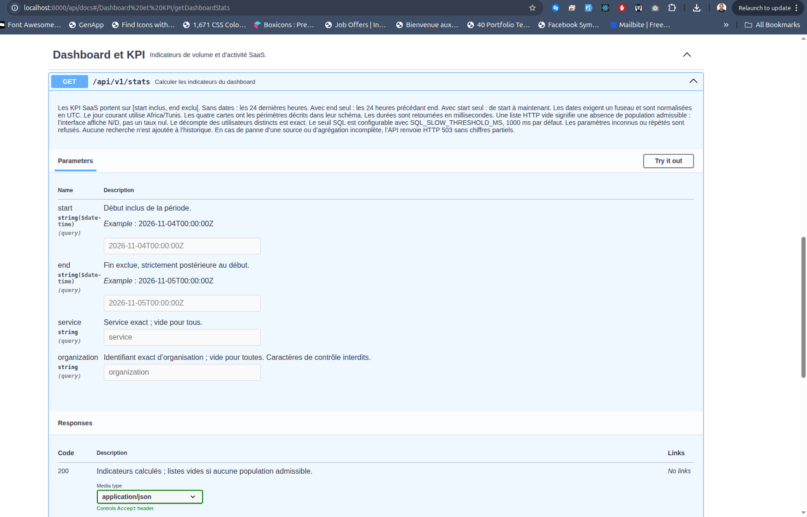
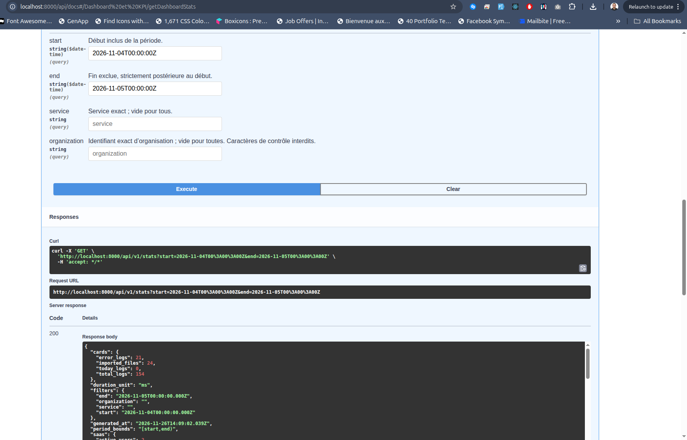

# SCRUM-23 — Guide du dashboard SaaS

## Accéder au dashboard

Ouvrir `/dashboard` ou cliquer sur « Dashboard » dans la navigation.

La page charge automatiquement les indicateurs des 24 dernières heures.
Les quatre cartes conservent chacune le périmètre indiqué sous leur valeur.

## Sélectionner une période

1. Renseigner le début inclus et la fin exclue dans les champs en UTC.
2. Renseigner éventuellement le service et l’organisation.
3. Cliquer sur « Afficher / Actualiser ».

Les dates des résultats sont affichées dans Africa/Tunis.
Par exemple, le 4 novembre 2026 à 00:00 UTC correspond à 01:00 à Tunis.

Selon la langue du navigateur, les champs peuvent afficher AM/PM :
12:00 AM correspond à minuit ; 12:00 PM correspond à midi.

Sans dates, la période couvre les 24 dernières heures.
Une fin seule sélectionne les 24 heures précédant cette fin.
Un début seul sélectionne la période allant de ce début à maintenant.

« Réinitialiser » efface les filtres et recalcule les 24 dernières heures.

## Lire les cartes

| Carte | Interprétation |
|---|---|
| Total des logs | Documents indexés sur toutes les dates, après filtres service et organisation |
| Logs du jour | Événements de la journée courante dans Africa/Tunis |
| Logs ERROR / CRITICAL | Événements de ces niveaux dans la période sélectionnée |
| Fichiers importés | Tous les imports confirmés, indépendamment des filtres sur les logs |

Importer aujourd’hui un fichier contenant des événements anciens
n’augmente pas nécessairement la carte des logs du jour.

## Lire les indicateurs SaaS

- Moyenne HTTP : durée moyenne en millisecondes par endpoint.
- Taux HTTP 5xx : proportion de réponses HTTP signalant une erreur serveur.
- SQL lent : nombre d’exécutions au-dessus du seuil et dix plus lentes.
- Utilisateurs actifs : identifiants distincts des événements HTTP ou métier.
- Fonctionnalités : nombre d’actions métier admissibles par fonctionnalité.

[Définitions et formules métier](formules-kpi.md)

## Absence de données et erreurs

Une période sans événement affiche des compteurs de période à zéro.
Les moyennes et taux sans population admissible affichent N/D.

Le total toutes dates et le compteur global des fichiers peuvent rester
non nuls pendant une période vide.

Une période inversée ou de durée nulle est refusée.
Les paramètres invalides produisent un message explicatif.

Pendant le chargement, les anciens résultats sont masqués.
En cas d’échec, ils restent masqués pour éviter de présenter des chiffres
anciens comme le résultat des nouveaux filtres.
Utiliser « Afficher / Actualiser » pour réessayer.

## API et Swagger

Endpoint : `GET /api/v1/stats`.

| Paramètre | Description |
|---|---|
| start | Date ISO 8601 avec fuseau, début inclus |
| end | Date ISO 8601 avec fuseau, fin exclue |
| service | Nom exact de service |
| organization | Identifiant exact d’organisation |

Les paramètres inconnus ou répétés sont refusés.
La documentation interactive est disponible dans `/api/docs`,
section « Dashboard et KPI ».

| Code HTTP | Signification |
|---|---|
| 200 | Indicateurs calculés, éventuellement sans population admissible |
| 400 | Paramètre invalide, code INVALID_FILTER |
| 503 | Source ou calcul indisponible, code STATS_UNAVAILABLE |

La consultation du dashboard ne crée pas d’entrée dans l’historique
des recherches.

## Validations réalisées

| Vérification | Preuve |
|---|---|
| Quatre événements de référence et résultats attendus | [Jeu de référence](validation-dashboard/kpi-reference.json) |
| Service, organisation, période vide et fuseaux équivalents | [Bilan des filtres](validation-dashboard/bilan-filtres.json) |
| Paramètres invalides, pannes simulées et résultats incomplets | [Bilan des erreurs](validation-dashboard/bilan-erreurs.json) |
| Minuit, bornes inclusives/exclusives, moyenne, 5xx et seuil SQL | [Cas limites](validation-dashboard/bilan-cas-limites.json) |
| Réponse sur les données existantes du 4 novembre | [Réponse API](validation-dashboard/dashboard-periode-reference.json) |

Les cas limites utilisent un index Elasticsearch temporaire distinct
des index de l’application, supprimé après le test.

## Résultats observés sur les données existantes

Pour la période du 4 novembre 2026 à 00:00 UTC au 5 novembre à 00:00 UTC,
sans filtre de service ni d’organisation :

| Indicateur | Résultat observé |
|---|---|
| Total des logs | 154 |
| Fichiers importés | 24 |
| Logs ERROR / CRITICAL dans la période | 21 |
| Moyenne HTTP sur /api/tasks | 125 ms, sur 91 requêtes |
| Réponses HTTP 5xx | 0 sur 91 |
| Exécutions SQL lentes | 21 |
| Utilisateurs actifs | 2 |
| Utilisations de tasks | 21 |

Ces valeurs décrivent le jeu présent lors de la validation.
Elles peuvent changer après de nouveaux imports.

## Captures Swagger

