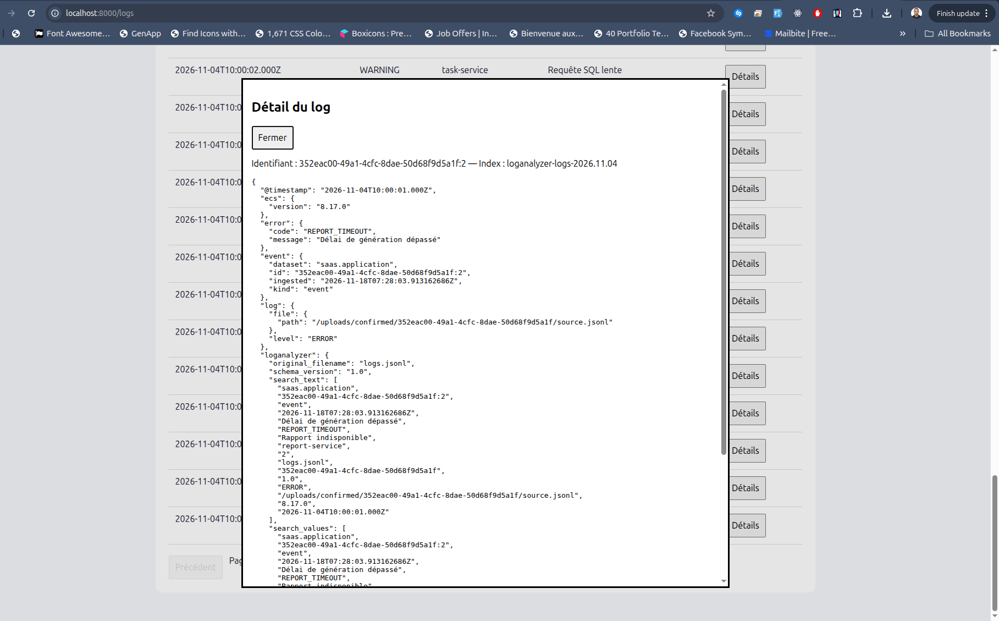
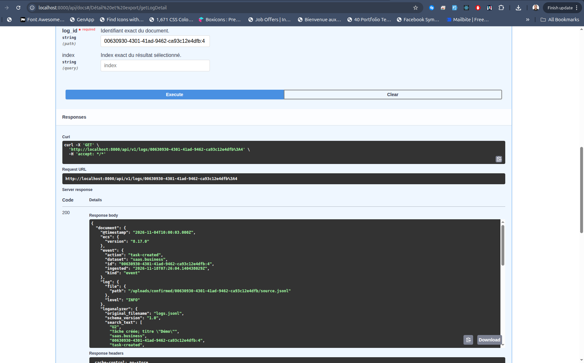
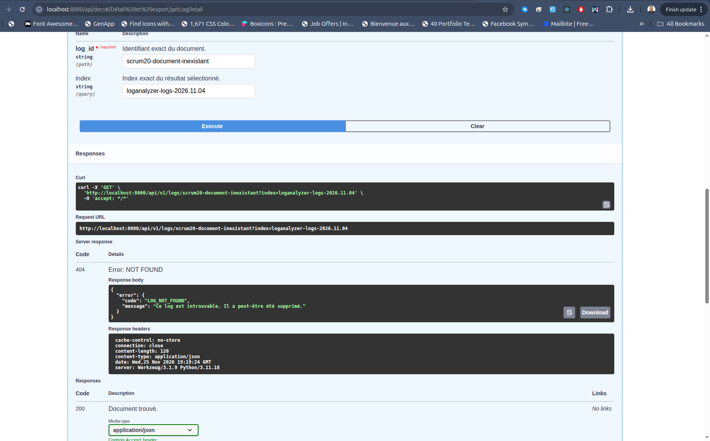
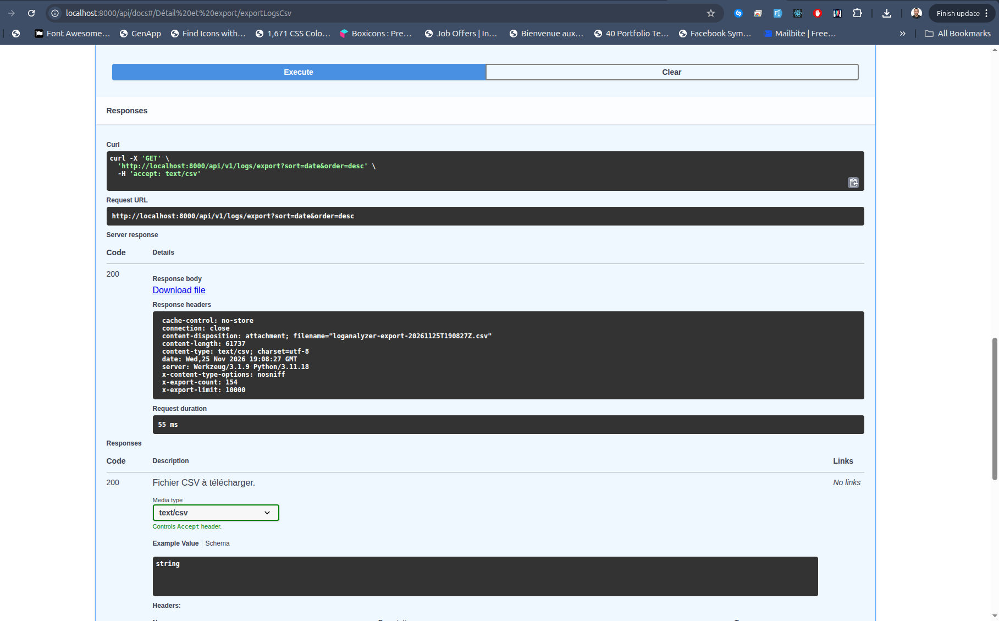
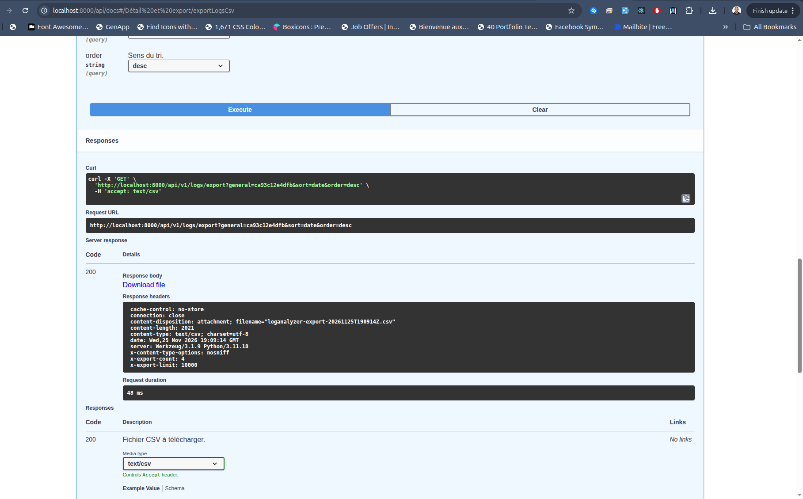

# SCRUM-20 — Détail d’un log et export CSV

## Fonctionnalités

La page `/logs` permet de consulter le document d’un résultat avec le bouton
« Détails » et d’exporter les résultats d’une recherche avec « Exporter en CSV ».

### Détail du log

Le bouton « Détails » ouvre une fenêtre présentant l’identifiant, l’index
et les champs du document Elasticsearch au format JSON.
Les champs techniques de recherche présents dans le document sont également affichés.
Le bouton « Fermer » permet de revenir aux résultats.

### Export CSV

L’export reprend les critères de la recherche affichée et son ordre de tri.
Il porte sur tous les résultats correspondants, toutes pages confondues,
et pas uniquement sur les 50 logs de la page courante.

Une confirmation explique le périmètre, le format et les limites avant
le téléchargement. Annuler ne déclenche aucun export.

La recherche est exécutée à nouveau au moment de l’export :
son contenu peut donc évoluer si les données indexées ont changé.

## API

Les deux opérations sont documentées et exécutables dans Swagger : `/api/docs`.
La spécification OpenAPI est disponible à `/api/openapi.json`.

### Consulter un document

`GET /api/v1/logs/{log_id}?index=loganalyzer-logs-2026.11.04`

- `log_id` : identifiant exact du document, obligatoire.
- `index` : index exact du résultat sélectionné, facultatif.
- Sans index, la recherche porte sur `loganalyzer-logs-*`.
- Si plusieurs index contiennent cet identifiant, préciser l’index.

La réponse de succès contient `id`, `index` et `document`.

| Statut HTTP | Signification |
|---|---|
| 200 | Document trouvé |
| 400 | Paramètre incorrect |
| 404 | Document introuvable |
| 409 | Identifiant présent dans plusieurs index |
| 503 | Consultation temporairement indisponible |

Un document introuvable renvoie le code `LOG_NOT_FOUND` et le message :
« Ce log est introuvable. Il a peut-être été supprimé. »

### Exporter une recherche

`GET /api/v1/logs/export`

| Paramètre | Rôle |
|---|---|
| `general` | Recherche générale dans les valeurs du document |
| `q` | Recherche dans les messages |
| `level` | Niveau exact |
| `service` | Service exact |
| `start`, `end` | Période inclusive sur la date de l’événement |
| `sort` | Tri par `date`, `level` ou `service` |
| `order` | Ordre `asc` ou `desc` |

Les critères sont combinés comme pour la recherche.
Le paramètre `page` n’est pas accepté : l’export couvre toutes les pages.

| Statut HTTP | Signification |
|---|---|
| 200 | Fichier CSV téléchargeable |
| 400 | Paramètre ou filtre incorrect |
| 422 | Limite du nombre de logs ou de la taille du fichier dépassée |
| 503 | Export temporairement indisponible |

Une recherche sans résultat produit un CSV contenant uniquement les en-têtes.

Les en-têtes HTTP comprennent :

- `Content-Type: text/csv; charset=utf-8` ;
- `Content-Disposition` avec le nom du fichier ;
- `X-Export-Count` avec le nombre de logs exportés ;
- `X-Export-Limit` avec la limite du nombre de logs.

## Format et limites

Le fichier utilise :

- 28 colonnes fixes avec les noms des champs ECS et les métadonnées du résultat ;
- le point-virgule comme séparateur ;
- l’encodage UTF-8 avec BOM, pour faciliter la reconnaissance des accents
  dans les tableurs ;
- des fins de ligne CRLF ;
- des cellules vides pour les champs absents ;
- un échappement CSV des guillemets, séparateurs et retours à la ligne.

Les colonnes sont :
`_index`, `_id`, `@timestamp`, `log.level`, `service.name`, `message`,
`event.dataset`, `event.kind`, `event.action`, `event.duration`,
`event.ingested`, `event.id`, `http.request.method`, `http.request.id`,
`http.response.status_code`, `url.path`, `user.id`, `organization.id`,
`error.code`, `error.message`, `saas.feature`, `saas.database.query_name`,
`log.file.path`, `loganalyzer.upload_id`, `loganalyzer.source_line`,
`loganalyzer.original_filename`, `loganalyzer.schema_version`, `ecs.version`.

`event.duration` conserve son unité ECS : la nanoseconde.
Les champs calculés `loganalyzer.search_text` et `loganalyzer.search_values`
ne sont pas exportés.

Les textes susceptibles d’être interprétés comme une formule par un tableur
sont préfixés par une apostrophe.

L’export est limité à **10 000 logs** et **20 Mio**.
Un dépassement est refusé avec un message explicite, sans fichier tronqué.

Ces seuils, le séparateur, le BOM et les 28 colonnes sont des choix
d’implémentation. Le sujet demande le détail et l’export CSV ;
les critères du ticket demandent des en-têtes cohérents, un encodage adapté
aux accents et un périmètre explicite.

## Vérifications réalisées

Les essais ont été réalisés le 25 novembre 2026 sur les données disponibles.

| Vérification | Résultat observé | Preuve |
|---|---|---|
| Consultation depuis l’interface | Fenêtre avec les champs du document | Capture de l’interface |
| Correspondance entre recherche et détail | Identifiant, index et document identiques | Vérification Python dans le terminal |
| Consultation dans Swagger | HTTP 200 et document retourné | Capture Swagger |
| Identifiant `scrum20-document-inexistant` | HTTP 404 et message compréhensible | Capture Swagger |
| Export sans filtre | HTTP 200, 154 logs | Capture et CSV complet |
| Export avec `general=ca93c12e4dfb` | HTTP 200, 4 logs du même import | Capture et CSV filtré |
| Lecture des deux CSV | 28 colonnes, UTF-8 avec BOM, aucune ligne de structure incorrecte | Analyse des fichiers conservés |
| Accents et guillemets | Message « Tâche créée; titre "Démo" » préservé | CSV conservés |
| Confirmation de l’export | Annulation et téléchargement vérifiés dans l’interface | Essai manuel |

### Export complet

[Fichier CSV complet : 154 logs](validation-detail-export/export-complet.csv)

### Export filtré

La recherche générale `ca93c12e4dfb` sélectionne les quatre événements
de l’import `00630930-4301-41ad-9462-ca93c12e4dfb`.

[Fichier CSV filtré : 4 logs](validation-detail-export/export-filtre.csv)

### Portée des vérifications

Les essais conservés couvrent les parcours de succès, un document introuvable
et un export avec un critère de recherche générale.

Les dépassements de 10 000 logs et de 20 Mio, les erreurs 409 et 503,
l’export vide et toutes les combinaisons de filtres n’ont pas été testés
dans cette campagne. Leurs comportements sont décrits ci-dessus
sans être présentés comme des essais validés.
