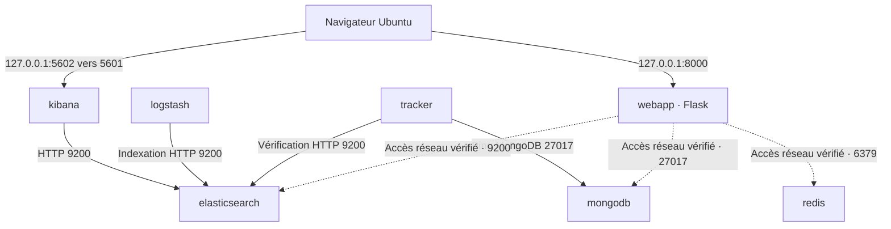

# Environnement Docker de LogAnalyzer

L'environnement local de SCRUM-13 contient sept services.
Le déploiement a été vérifié sur Ubuntu avec Docker Engine 29.4.1
et Docker Compose 5.1.3, acceptés par l'enseignant.

## Services et versions

| Service Compose | Logiciel ou image | Rôle actuel |
|---|---|---|
| elasticsearch | Elasticsearch 8.19.0 | Indexation et recherche |
| kibana | Kibana 8.19.0 | Interface de consultation |
| logstash | Logstash Wolfi 8.19.0 | Pipeline HTTP de test vers Elasticsearch |
| mongodb | MongoDB 7.0.45 | Stockage des métadonnées |
| redis | Redis 7.4.12-alpine | Cache prévu pour les indicateurs |
| webapp | Python 3.11-slim et Flask 3.1.2 | Page d'accueil et route /health |
| tracker | Python 3.11-slim et PyMongo 4.10.1 | Vérification des connexions et du dossier partagé |

Les versions des bibliothèques Python sont déclarées dans les fichiers
requirements.txt. L'image de base python:3.11-slim peut recevoir des mises
à jour de correctifs.

Le suivi métier des imports sera développé dans SCRUM-17.
Les pipelines de fichiers et les mappings seront développés dans SCRUM-16.

## Configuration locale

Depuis la racine du dépôt, créer la configuration locale.

```bash
cp --update=none .env.example .env
```

Cette commande copie le modèle sans remplacer un fichier .env existant.

Le fichier .env est ignoré par Git. Le modèle .env.example est versionné.

| Variable | Utilité |
|---|---|
| COMPOSE_PROJECT_NAME | Préfixe des ressources Docker |
| WEB_PORT | Port de l'application sur Ubuntu |
| KIBANA_PORT | Port de Kibana sur Ubuntu |
| ELASTIC_VERSION | Version commune Elasticsearch, Kibana et Logstash |
| ELASTICSEARCH_HOST / ELASTICSEARCH_PORT | Adresse interne d'Elasticsearch |
| MONGODB_IMAGE_TAG | Version de l'image MongoDB |
| MONGODB_HOST / MONGODB_PORT | Adresse interne de MongoDB |
| MONGODB_DATABASE | Nom prévu pour la base applicative |
| REDIS_IMAGE_TAG | Version de l'image Redis |
| REDIS_HOST / REDIS_PORT | Adresse interne de Redis |

Les valeurs par défaut utilisent les noms de services Compose.
Le tracker effectue actuellement son ping dans la base d'administration
MongoDB. La base applicative sera utilisée lors du suivi des imports.

## Démarrage et arrêt

Vérifier la configuration.

```bash
docker compose config --quiet
```

Construire les images Python et démarrer les services.

```bash
docker compose up -d --build --wait
```

Le premier démarrage télécharge les images. Sa durée dépend de la connexion
Internet. Kibana et Logstash peuvent prendre plusieurs minutes.

Afficher les services, y compris ceux qui sont arrêtés.

```bash
docker compose ps -a
```

Consulter les journaux d'un service.

```bash
docker compose logs --tail=60 tracker
```

Arrêter les services en conservant les conteneurs et volumes.

```bash
docker compose stop
```

Relancer l'environnement après un arrêt ou un redémarrage du poste.

```bash
docker compose up -d --wait
```

Supprimer les conteneurs et le réseau Compose en conservant les volumes nommés.

```bash
docker compose down
```

L'option `down -v` supprime les volumes et leurs données.
Elle ne doit pas être utilisée pour un arrêt habituel.

## Accès et réseau

| Service | Accès depuis Ubuntu | Port dans Docker |
|---|---|---|
| webapp | http://localhost:8000 | 8000 |
| kibana | http://localhost:5602 | 5601 |
| elasticsearch | Réseau Docker uniquement | 9200 |
| mongodb | Réseau Docker uniquement | 27017 |
| redis | Réseau Docker uniquement | 6379 |
| logstash | Réseau Docker uniquement | 8080 pour le test, 9600 pour l'API |
| tracker | Programme en arrière-plan | Aucun port applicatif |

Les ports publiés sont liés à 127.0.0.1.
Tous les services rejoignent le réseau bridge loganalyzer_net.
Avec le nom de projet par défaut, Docker le nomme
loganalyzer_loganalyzer_net.

Les services Elasticsearch des TP utilisent leurs propres données.
Le projet dispose d'un cluster distinct nommé loganalyzer.

## Déploiement actuel



Les échanges applicatifs de Flask avec MongoDB et Redis seront implémentés
dans les tickets fonctionnels. Les accès réseau ont été vérifiés depuis
son conteneur.

## Volumes et fichiers partagés

| Volume ou montage | Utilisation |
|---|---|
| es_data | Données Elasticsearch dans /usr/share/elasticsearch/data |
| mongo_data | Données MongoDB dans /data/db |
| logstash_data | Données de fonctionnement Logstash dans /usr/share/logstash/data |
| uploads | Fichiers partagés entre webapp, tracker et Logstash |
| ./logstash/pipeline | Configuration locale montée en lecture seule dans Logstash |

Le volume uploads est accessible dans /app/uploads pour Flask et dans
/uploads pour le tracker et Logstash. Logstash dispose d'un accès en lecture seule.

Redis sert de cache reconstructible. La configuration ne prévoit pas
de volume nommé pour garantir sa conservation.

## Contrôles de santé et dépendances

Chaque service possède un healthcheck.

- Redis répond à PING.
- MongoDB répond à une commande ping.
- Elasticsearch atteint au moins l'état yellow.
- Kibana répond sur /api/status.
- Logstash expose le pipeline main dans son API.
- Flask répond sur /health.
- Le tracker vérifie MongoDB, Elasticsearch et l'accès au dossier uploads.

Kibana et Logstash attendent Elasticsearch.
Flask attend Elasticsearch, MongoDB et Redis.
Le tracker attend Elasticsearch et MongoDB.

## Ressources et configuration locale

Elasticsearch est limité à 2 Gio avec 1 Gio de mémoire Java.
Kibana est limité à 1 Gio.
Logstash est limité à 1,5 Gio avec 512 Mio de mémoire Java.
Flask et le tracker sont chacun limités à 256 Mio.
MongoDB et Redis n'ont actuellement pas de limite mémoire explicite.

L'authentification Elasticsearch est désactivée pour cet environnement
local. Flask utilise son serveur de développement.

## Vérifications réalisées pour SCRUM-13

- Sept services démarrés avec des contrôles de santé réussis.
- Interface Kibana accessible sur localhost:5602.
- Page Flask et route /health accessibles sur localhost:8000.
- Événement transmis par Logstash puis retrouvé dans Elasticsearch.
- Connexions réseau de Flask vers Elasticsearch, MongoDB et Redis.
- Ping MongoDB et requête Elasticsearch depuis le tracker.
- Document MongoDB conservé après recréation du conteneur.
- Document Elasticsearch conservé après recréation du conteneur.
- Fichier écrit par Flask et lu depuis Logstash.
- Fichier partagé conservé après recréation du conteneur Flask.

## Difficultés résolues

L'image Logstash standard présentait une erreur d'exécution sur le poste.
La variante officielle logstash-wolfi:8.19.0 a permis le démarrage.

La variable API_HTTP_HOST a été retirée pour éviter un conflit avec
le réglage http.host déjà fourni par l'image.