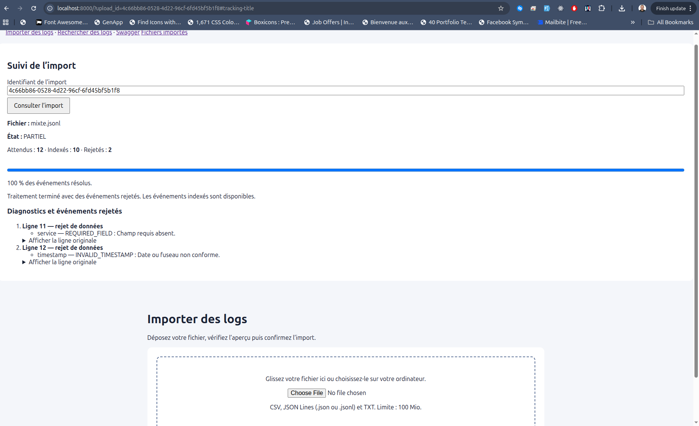
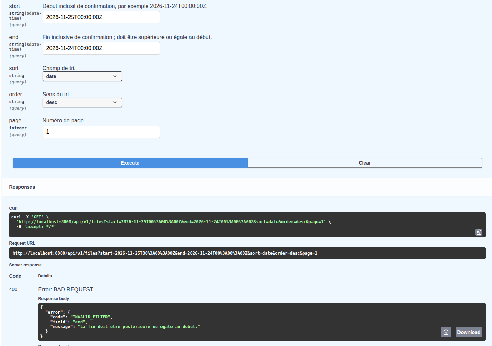

# SCRUM-21 — Consultation des fichiers importés

## Objectif

La page `/files` présente les métadonnées des imports confirmés.
Une ligne représente un import de fichier, et non un événement de log.

Les informations proviennent de la collection MongoDB `imports`,
déjà utilisée par le suivi d’import. Aucun second suivi n’est créé.

Les événements indexés restent consultables dans Elasticsearch
depuis la recherche de logs.

## Guide utilisateur

### Ouvrir la liste

Cliquer sur « Fichiers importés » dans la navigation.

La liste affiche :

- le nom du fichier ;
- sa date de confirmation en UTC ;
- sa taille en octets ;
- son statut de traitement ;
- les nombres de logs attendus, indexés et rejetés ;
- un lien « Consulter le suivi ».

La date correspond à la confirmation de l’import après l’aperçu.
Les aperçus non confirmés ou annulés ne figurent pas dans cette liste.

Une valeur « — » indique une information non encore disponible.

### Rechercher et filtrer

Le champ « Nom du fichier » accepte une partie du nom, sans distinction
entre majuscules et minuscules.

À partir de quatre caractères contenant une lettre, la recherche tolère
une modification sur une partie délimitée du nom :
caractère ajouté, supprimé, remplacé ou deux caractères voisins inversés.

Exemple vérifié : `mite` retrouve `mixte.jsonl`.

Les caractères spéciaux saisis sont traités littéralement.
La recherche est limitée à 100 caractères.

Sélectionner éventuellement un statut et une période,
puis cliquer sur « Afficher / Actualiser ».

Les critères de nom, de statut et de période sont combinés.
La période porte sur la date de confirmation et ses bornes sont inclusives.
Les heures saisies dans le formulaire sont interprétées en UTC.

« Réinitialiser » efface les critères et recharge la première page.

La recherche approchée par nom est une amélioration du projet,
ajoutée aux filtres par date et statut demandés dans SCRUM-21.

### Trier et parcourir les pages

Choisir un champ et un ordre, puis cliquer sur « Afficher / Actualiser ».

| Tri | Valeur utilisée |
|---|---|
| Date | Date de confirmation |
| Nom | Nom du fichier |
| Taille | Taille en octets |
| Statut | Ordre alphabétique du code stocké |
| Logs | Nombre de logs indexés |

Le nom et le statut suivent l’ordre des chaînes stockées dans MongoDB.
Le tri du statut ne représente pas une progression du traitement.

La liste contient au maximum 20 fichiers par page.
Les boutons « Précédent » et « Suivant » conservent les critères actifs.
Une nouvelle recherche repart de la première page.

Le compteur indique le nombre total d’imports correspondants
et le nombre affiché sur la page courante.

La liste est actualisée à la demande avec « Afficher / Actualiser ».

### Consulter le suivi d’un fichier

Cliquer sur « Consulter le suivi » dans la ligne souhaitée.

La page d’import s’ouvre avec l’identifiant sélectionné dans l’URL.
Le suivi démarre automatiquement pour cet import, même si un autre import
était précédemment mémorisé dans le navigateur.

Le suivi présente l’état du traitement, les compteurs et les diagnostics
disponibles pour les événements rejetés.

Exemple : `mixte.jsonl`, import
`4c66bb86-0528-4d22-96cf-6fd45bf5b1f8`, est PARTIEL :
12 événements attendus, 10 indexés et 2 rejetés.
Les diagnostics concernent les lignes 11 et 12.

### Comprendre les messages

| Situation | Comportement |
|---|---|
| Chargement | Message « Chargement des fichiers… » |
| Aucun fichier correspondant | Message explicite et tableau vide |
| Critères incorrects | Message expliquant le filtre à corriger |
| MongoDB indisponible | Message d’indisponibilité temporaire |
| Problème de connexion | Message invitant à réessayer |

Une indisponibilité ne doit pas être présentée comme une absence d’imports.

## API

`GET /api/v1/files`

L’opération est documentée dans Swagger à `/api/docs`.
La spécification OpenAPI est disponible à `/api/openapi.json`.

| Paramètre | Description | Valeur par défaut |
|---|---|---|
| `filename` | Recherche littérale ou approchée dans le nom, maximum 100 caractères | Vide |
| `status` | Statut exact du traitement | Tous |
| `start` | Début inclusif sur `confirmed_at`, date ISO 8601 avec fuseau | Aucun |
| `end` | Fin inclusive sur `confirmed_at`, date ISO 8601 avec fuseau | Aucune |
| `sort` | `date`, `name`, `size`, `status`, `logs` | `date` |
| `order` | `asc` ou `desc` | `desc` |
| `page` | Entier de 1 à 1 000 000 | 1 |

Les statuts acceptés sont :
`EN_ATTENTE`, `EN_COURS`, `TERMINE`, `PARTIEL`, `ECHEC`.

Les paramètres inconnus ou répétés sont refusés.
La fin de période doit être supérieure ou égale au début.

La réponse contient `items`, `total`, `page`, `page_size`, `total_pages`,
`has_previous`, `has_next` et `filters`.

Les lignes contiennent les métadonnées et compteurs du suivi.
Les dates sont retournées en UTC et les informations absentes à `null`.

| HTTP | Signification |
|---|---|
| 200 | Liste paginée, éventuellement vide |
| 400 | `INVALID_FILTER`, avec le champ et le motif |
| 503 | `FILES_UNAVAILABLE`, suivi MongoDB indisponible |

Une page au-delà des résultats, dans la plage autorisée,
retourne une liste vide avec le total réel.

Les réponses utilisent `Cache-Control: no-store`.

## Vérifications réalisées

Les essais ont été réalisés sur une base de 24 imports.

| Vérification | Résultat | Preuve |
|---|---|---|
| Première page | 20 imports, total 24 | [JSON](validation-fichiers/fichiers-page-1.json) |
| Deuxième page | 4 imports, sans doublon avec la première | [JSON](validation-fichiers/fichiers-page-2.json) |
| Filtre PARTIEL | 6 imports partiels | [JSON](validation-fichiers/fichiers-statut-partiel.json) |
| Période sans import | Total 0, liste vide | [JSON](validation-fichiers/fichiers-periode-vide.json) |
| Période inversée | HTTP 400, erreur sur `end` | Capture ci-dessous |
| Nom `mite` et statut PARTIEL | Fichiers correspondant à `mixte` | [JSON](validation-fichiers/fichiers-nom-faute-mite.json) |
| Nom approché, statut et période combinés | Critères respectés | [JSON](validation-fichiers/fichiers-filtres-combines.json) |
| Tris date et taille, croissants et décroissants | Ordre vérifié sur les 24 imports | [Bilan](validation-fichiers/bilan-tris-filtres.json) |
| Accès au suivi | Import sélectionné et diagnostics affichés | Capture du suivi |
| Panne MongoDB simulée | HTTP 503, code FILES_UNAVAILABLE et message explicite | Test Flask isolé exécuté dans le conteneur |

Le test d’indisponibilité utilise un client simulé.
Il n’arrête pas MongoDB et ne modifie pas les données.
Il vérifie la réponse de l’API, sans constituer un essai de panne réelle
ni une vérification visuelle de l’erreur dans le navigateur.

Les tris par nom, statut et nombre de logs sont disponibles,
mais n’ont pas fait l’objet des contrôles automatiques de tri ci-dessus.

## Choix et limites

Les 20 fichiers par page, la limite du numéro de page et les règles
de recherche approchée sont des choix d’implémentation.

La date affichée est `confirmed_at`, disponible dans le suivi existant ;
elle ne constitue pas une mesure séparée du début de l’upload.

Deux imports peuvent porter le même nom. Leur identifiant permet
de les distinguer : la liste ne déduplique pas les envois par nom.

La recherche approchée peut retourner plusieurs noms proches.
Elle ne garantit pas de retrouver toutes les saisies comportant
plusieurs fautes.

Les vérifications réalisées ne constituent pas un test de charge.
