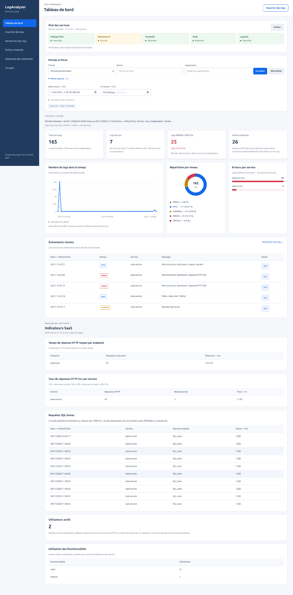
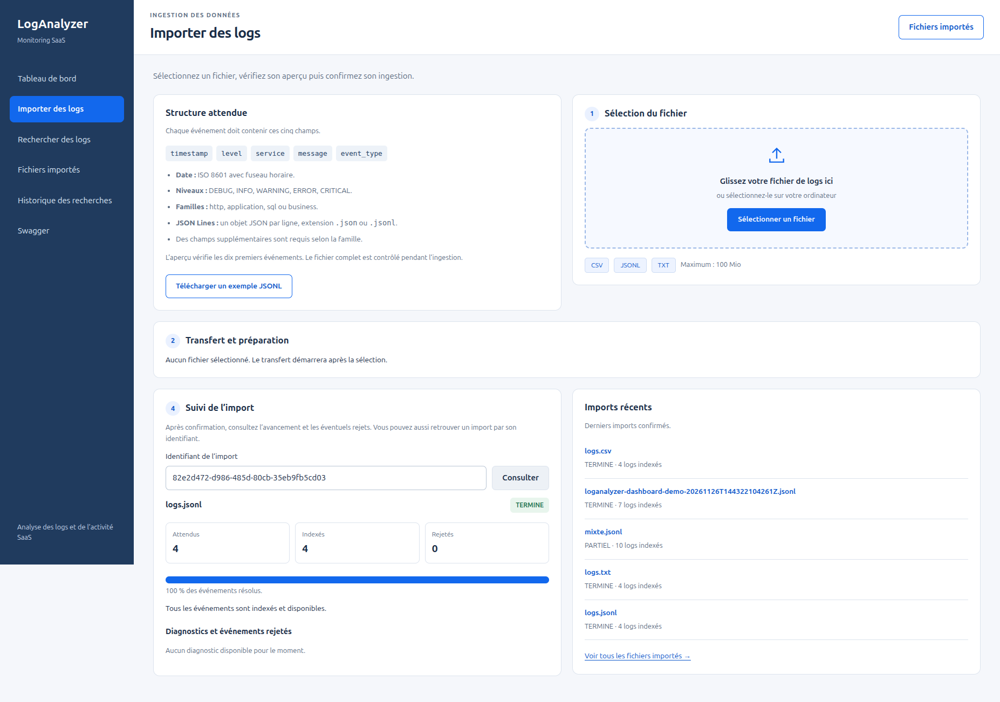
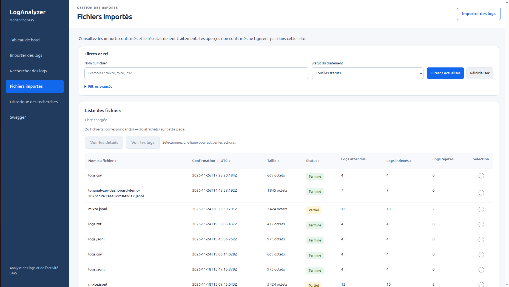
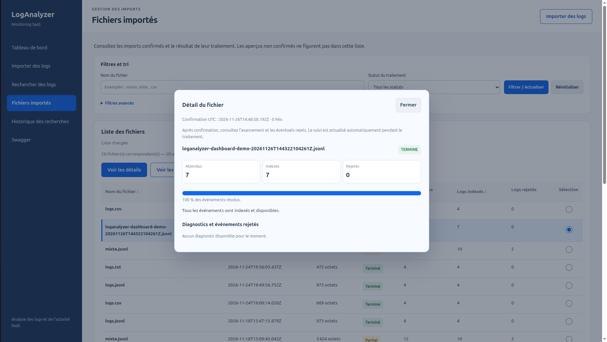
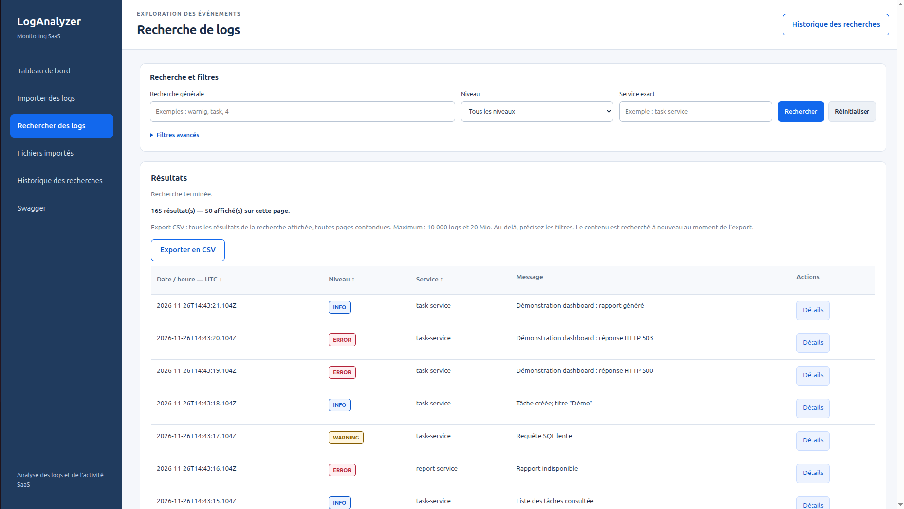
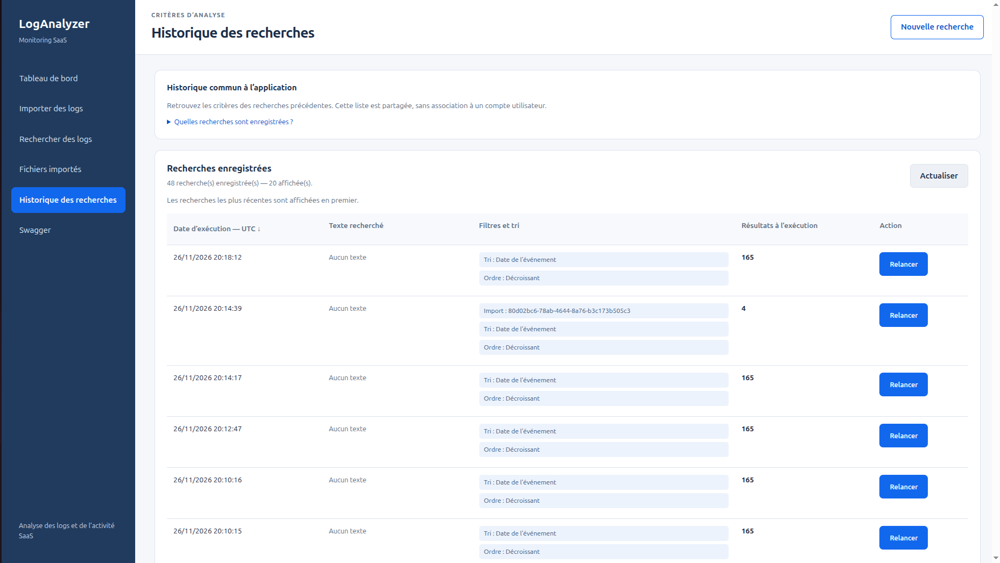
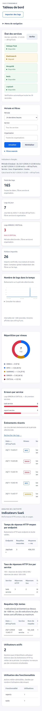
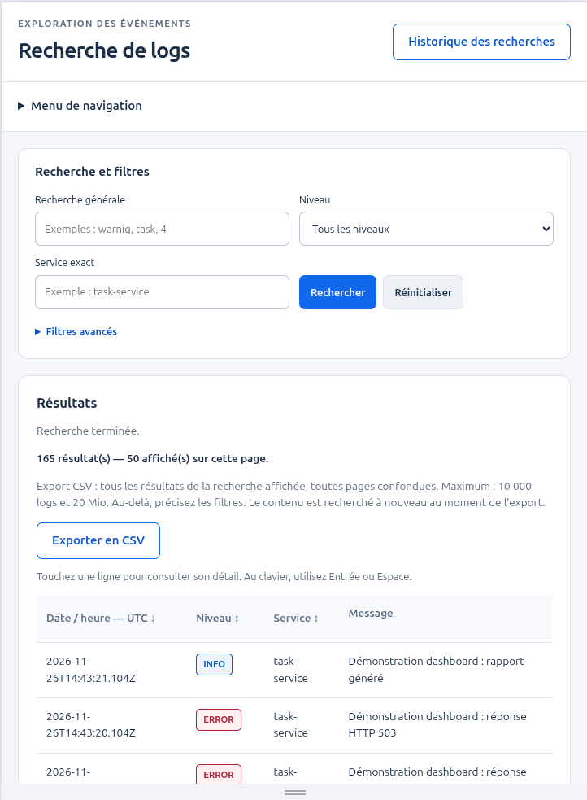

# Guide utilisateur — LogAnalyzer

## Navigation

L’application comporte six écrans principaux : tableau de bord,
import de logs, fichiers importés, recherche de logs, historique
des recherches et visualisations Kibana. La navigation latérale indique la page active.
Sur petit écran, les liens sont accessibles dans « Menu de navigation ».

Le bouton « Swagger », situé à côté d’« Importer des logs » dans
l’en-tête du tableau de bord, ouvre la documentation API dans un nouvel onglet.
Le menu « Visualisations Kibana » ouvre le dashboard intégré.

## Tableau de bord

Choisir une période, éventuellement un service et une organisation,
puis cliquer sur « Actualiser ». Les dates personnalisées se trouvent
dans « Filtres avancés ». Les dates saisies sont en UTC.

La période des indicateurs est à début inclus et fin exclue.
Le total des logs couvre toutes les dates avec les filtres de service
et d’organisation. Les logs du jour utilisent la journée Africa/Tunis.
Le nombre de fichiers importés est un compteur global des imports confirmés.

Les graphiques présentent le volume dans le temps, la répartition
par niveau et les erreurs par service. Survoler ou sélectionner au clavier
les éléments interactifs permet de consulter leurs informations.
La section « Consulter les valeurs » donne accès aux valeurs du graphique
temporel.

Les indicateurs SaaS présentent les durées HTTP en millisecondes,
le taux de réponses HTTP 5xx, les requêtes SQL lentes, les utilisateurs
distincts et l’utilisation des fonctionnalités. Les utilisateurs actifs
ne représentent pas des connexions simultanées.

L’état de Flask, Elasticsearch, MongoDB, Redis, Logstash et Kibana est vérifié
automatiquement toutes les 30 secondes. Le bouton « Vérifier » déclenche
un nouveau contrôle. Un contrôle de disponibilité ne garantit pas
le succès d’une ingestion complète.

Elasticsearch peut être « Dégradé » avec toutes les données primaires
disponibles lorsque certaines répliques ne peuvent pas être allouées
sur le cluster à un seul nœud.

Les KPI peuvent être réutilisés depuis Redis pendant leur durée de vie.
La date de calcul permet de situer la fraîcheur des résultats.

## Importer des logs

Consulter la structure attendue ou télécharger le fichier exemple.
Sélectionner ensuite un fichier ou le déposer dans la zone prévue.
La taille maximale autorisée est affichée à l’écran.

La section « Transfert et préparation » affiche la progression de l’envoi.
L’aperçu présente les dix premiers événements et leurs éventuelles erreurs.
Il ne remplace pas le contrôle du fichier complet pendant l’ingestion.

Confirmer un aperçu admissible pour lancer le traitement, ou annuler
le dépôt avant confirmation. Le suivi distingue le transfert du fichier
de son traitement et de son indexation.

La section « Suivi de l’import » présente les événements attendus,
indexés et rejetés ainsi que les diagnostics disponibles.
La progression représente les événements résolus, indexés ou rejetés :
100 % ne signifie donc pas nécessairement que tous les événements
ont été indexés.

## Fichiers importés

Filtrer par nom et statut. Les dates et le tri sont accessibles
dans « Filtres avancés ». Les dates portent sur la confirmation de
l’import et leurs bornes sont inclusives.

Cliquer sur une ligne ou utiliser son bouton de sélection.
Les actions « Voir les détails » et « Voir les logs », initialement
désactivées, deviennent disponibles pour le fichier sélectionné.

« Voir les détails » ouvre une popup avec le suivi et les diagnostics.
« Voir les logs » ouvre la recherche filtrée sur l’identifiant de l’import.
Changer de page, trier ou actualiser la liste efface la sélection.

## Rechercher des logs et exporter

Renseigner la recherche générale, un niveau ou un service, puis cliquer
sur « Rechercher ». Les filtres avancés permettent de préciser le texte
du message, les dates, le tri et l’identifiant d’un import.

Les dates de recherche portent sur les événements ; les deux bornes
sont inclusives et les heures saisies sont en UTC.

Sur ordinateur, le bouton « Détails » ouvre les champs et le JSON
d’un événement. Dans la présentation responsive, toucher une ligne
ouvre ce même détail. Les lignes interactives sont également utilisables
avec Entrée ou Espace.

« Exporter en CSV » exporte les résultats filtrés, toutes pages confondues,
dans la limite de 10 000 logs et 20 Mio. Au-delà, préciser les filtres.
L’export relit les données : son contenu peut évoluer depuis la recherche
affichée.

## Historique des recherches

L’historique est commun à l’application, sans association à un compte.
Il conserve la date d’exécution, les textes recherchés, les filtres,
le tri et le nombre de résultats obtenu lors de l’exécution.

Les recherches réussies en première page sont enregistrées, y compris
celles sans résultat et le chargement initial de la page de recherche.
La pagination seule ne crée pas d’entrée supplémentaire.

« Relancer » ouvre la recherche avec les critères enregistrés et
l’exécute de nouveau. Le résultat peut différer si les données ont changé.

## Visualisations Kibana

Ouvrir « Visualisations Kibana » dans le menu.
Le dashboard présente le temps de réponse HTTP moyen par route,
l’évolution des erreurs HTTP 5xx et les utilisateurs actifs distincts.

Le sélecteur de période intégré à Kibana filtre les trois panneaux.
Cette période est indépendante de celle du tableau de bord Flask.
L’affichage intégré démarre sur les 30 derniers jours.

« Ouvrir dans Kibana » ouvre le dashboard dans un nouvel onglet.
« Vérifier / Recharger » contrôle sa disponibilité et recharge
l’affichage intégré ; la période peut revenir à sa valeur initiale.

Si le service est indisponible, un message remplace le dashboard.
Si le service répond mais que l’affichage reste incorrect,
utiliser le bouton de signalement du problème d’affichage,
puis réessayer ou ouvrir directement Kibana.

Le contrôle automatique de disponibilité ne constitue pas
un rafraîchissement automatique des données des graphiques.

Les utilisateurs actifs sont des identifiants distincts sur la période,
et non des connexions simultanées. Le décompte Kibana peut être approximatif.
Sur la journée vide testée, la carte affiche « N/A ».

[Configuration, formules et validation Kibana](kibana.md)

## Messages et états

- Chargement : un message indique l’opération en cours et les commandes
  concernées sont temporairement désactivées.
- Vide : un message distingue l’absence de résultats d’une erreur.
  Vérifier les filtres ou importer des données selon le contexte.
- Succès : le résultat, les compteurs ou le statut du traitement
  sont affichés.
- Erreur : lire le message, corriger les paramètres ou réessayer.
  Un import partiel conserve les événements indexés et présente les rejets.

Les popups se ferment avec « Fermer » ou Échap.
Les transitions sont discrètes et respectent la préférence système
de réduction des mouvements.

## Adaptation aux petits écrans

Les blocs s’empilent, la navigation se replie et les formulaires
s’adaptent à la largeur disponible. Les tableaux larges disposent
d’un défilement horizontal local lorsque nécessaire.

Les vérifications manuelles de disposition et d’utilisation ont été
confirmées par le porteur du projet aux largeurs de 324 px et 720 px,
en complément de la version ordinateur. Les captures ci-dessous
illustrent le rendu ; elles ne prouvent pas à elles seules tous
les parcours ni les animations.

La nouvelle page Kibana a également été vérifiée manuellement
par le porteur du projet à 324 et 720 px : navigation,
sélecteur de période et ouverture directe utilisables.

## Écarts justifiés par rapport aux maquettes

| Écart | Justification |
|---|---|
| Filtres avancés repliables | Réduire la hauteur des formulaires et rendre les résultats plus accessibles. |
| Détails des fichiers en popup plutôt qu’en panneau latéral | Conserver la position du tableau et proposer le même principe de consultation aux différentes largeurs. |
| Actions communes après sélection d’un fichier | Éviter les boutons répétés sur chaque ligne et supprimer le lien redondant « Suivi complet ». |
| Structure attendue placée avant la sélection du fichier | Garder la sélection et la progression du transfert à la suite sur petit écran. |
| Six contrôles de services dans le dashboard | Présenter les contrôles disponibles sur Flask, Elasticsearch, MongoDB, Redis, Logstash et Kibana. Le tracker conserve son contrôle de santé Docker. |
| Indicateurs SaaS ajoutés sous la vue d’ensemble | Intégrer les indicateurs effectivement développés dans SCRUM-23. |
| Détails des logs accessibles par la ligne en responsive | Économiser la place de la colonne d’actions et faciliter l’utilisation tactile. |
| Pagination de 20 fichiers, 20 recherches historiques et 50 logs | Respecter les tailles de page actuellement prises en charge par les API. |
| Annulation du dépôt après réception de l’aperçu | L’interface actuelle ne propose pas d’interruption du transfert en cours, contrairement à l’intention de la maquette. |
| États affichés selon la situation réelle | Les blocs explicatifs de chargement, vide et erreur des maquettes ne sont pas reproduits en permanence dans les écrans. |

Les couleurs et la navigation sont harmonisées entre les six écrans.
Les chiffres des maquettes étaient illustratifs ; les interfaces
présentent les résultats des données et filtres réellement utilisés.
