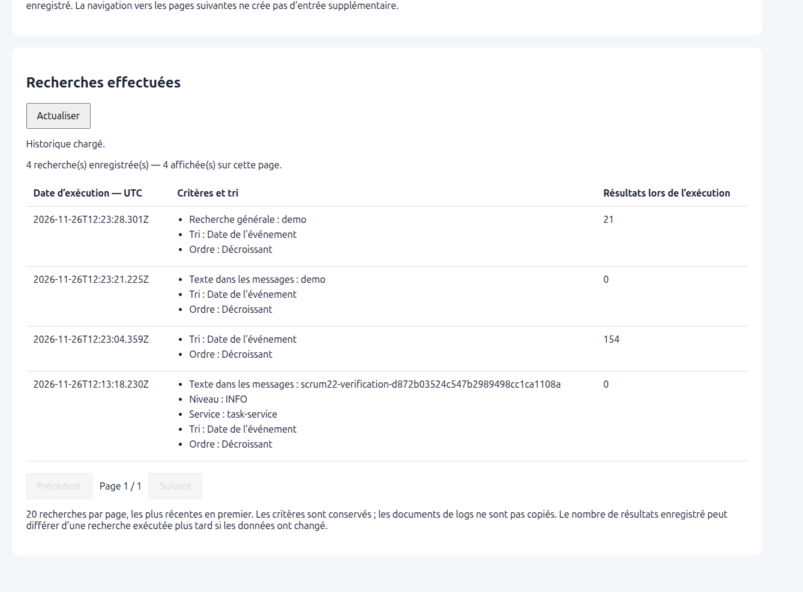

# SCRUM-22 — Historique des recherches

## Objectif et portée

La page `/search-history` permet de consulter les recherches de logs
exécutées depuis la mise en place de cette fonctionnalité.

L’historique est commun à l’application. Aucun compte utilisateur,
identifiant de session ou navigateur n’est associé aux entrées.

Les données sont enregistrées dans la collection MongoDB `search_history`.
Les documents de logs restent dans Elasticsearch et ne sont pas copiés.

[Schéma MongoDB de l’historique](schema-historique-recherches.md)

## Guide utilisateur

### Enregistrer une recherche

1. Ouvrir « Rechercher des logs » dans la navigation.
2. Renseigner les critères souhaités et le tri.
3. Cliquer sur « Rechercher ».
4. Après une réponse réussie, ouvrir « Historique des recherches ».

Une recherche réussie sur la première page est enregistrée automatiquement,
même si elle ne trouve aucun résultat.

Le chargement initial de la page de recherche et la réinitialisation
exécutent également une recherche et créent une entrée.

Relancer les mêmes critères crée une nouvelle entrée datée.
La navigation vers les pages suivantes ne crée pas d’entrée supplémentaire.
Revenir à la page 1 exécute une nouvelle recherche et crée une entrée.

Les filtres invalides, les échecs Elasticsearch et les exports CSV
ne sont pas enregistrés dans cet historique.

### Consulter les recherches précédentes

Cliquer sur « Historique des recherches ».

Chaque ligne indique :

- la date d’exécution en UTC ;
- les critères renseignés et le tri ;
- le nombre total de résultats observé lors de l’exécution.

Les critères vides ne sont pas affichés.
Le tri et son ordre restent visibles même pour une recherche sans filtre.

Les recherches les plus récentes apparaissent en premier.
La page contient au maximum 20 entrées.
Les boutons « Précédent » et « Suivant » permettent de parcourir la liste.
« Actualiser » recharge la première page.

Consulter ou actualiser l’historique ne crée pas de nouvelle recherche.

Cette page permet de consulter les critères précédents.
Elle ne propose pas de bouton de relance automatique dans SCRUM-22.

### Comprendre les compteurs

Le nombre conservé représente les résultats lors de l’exécution.
Il peut différer d’une recherche ultérieure si les données ont changé.

La capture et le JSON conservés montrent quatre recherches :

| Critères principaux | Résultats observés |
|---|---:|
| Recherche générale : demo | 21 |
| Texte dans les messages : demo | 0 |
| Aucun filtre, tri par date décroissante | 154 |
| Texte de vérification, niveau INFO, service task-service | 0 |

Ces nombres correspondent aux données disponibles lors des essais.
L’historique conserve séparément la recherche générale et celle
dans les messages ; elles peuvent produire des résultats différents.

### Comprendre les états et erreurs

| Situation | Comportement |
|---|---|
| Chargement | Message de chargement |
| Historique vide | Message indiquant qu’aucune recherche n’est enregistrée |
| Consultation MongoDB impossible | Message d’indisponibilité temporaire |
| Connexion au serveur impossible | Message invitant à réessayer |
| Enregistrement MongoDB non confirmé | Résultats de recherche conservés avec un avertissement |

Un échec d’enregistrement n’est pas présenté comme une absence de résultats.

## API et documentation Swagger

`GET /api/v1/search-history`

L’opération est disponible dans Swagger à `/api/docs`.
La spécification est disponible à `/api/openapi.json`.

Le seul paramètre accepté est `page`, entier de 1 à 1 000 000,
avec la valeur 1 par défaut. La taille des pages est fixée à 20.

Les paramètres inconnus ou répétés sont refusés.

La réponse contient items, total, page, page_size, total_pages,
has_previous, has_next et scope.

Chaque entrée contient id, executed_at, criteria et result_count.
La portée scope vaut application.

| HTTP | Signification |
|---|---|
| 200 | Historique paginé, éventuellement vide |
| 400 | INVALID_FILTER, avec le champ concerné |
| 503 | HISTORY_UNAVAILABLE |

Les réponses utilisent Cache-Control: no-store.
Une page au-delà des entrées disponibles retourne une liste vide.

La réponse de recherche `GET /api/v1/logs` contient aussi un objet history :

- recorded=true et id lorsque l’écriture est confirmée ;
- recorded=false et reason=pagination pour une page suivante ;
- recorded=false, reason=unavailable et un message si l’écriture échoue.

## Vérifications réalisées

| Vérification | Résultat et preuve |
|---|---|
| Enregistrement réel avec critères et date | Vérification Python contre les API |
| Recherche sans résultat conservée | Entrée de vérification avec compteur 0 |
| Navigation vers la page 2 des logs | Pas d’entrée supplémentaire, vérification Python |
| Consultation dans l’interface | Capture de quatre recherches |
| Consultation Swagger | JSON de quatre recherches, portée application |
| Page 0 refusée | HTTP 400, INVALID_FILTER sur page, vérifié avec curl |
| Consultation MongoDB indisponible | HTTP 503 avec dépendance simulée |
| Écriture MongoDB indisponible | Recherche HTTP 200 et avertissement |
| Pagination pendant une panne MongoDB | Aucune tentative d’écriture |
| Filtre de logs invalide | Aucun enregistrement |
| Échec Elasticsearch | Aucun enregistrement |

[Réponse Swagger conservée](validation-historique/historique-liste.json)

[Bilan des six contrôles isolés](validation-historique/bilan-erreurs.json)

Les tests isolés utilisent Flask test_client et des dépendances simulées.
Ils n’arrêtent pas les services et ne modifient pas les données MongoDB.

La navigation de l’historique sur plus de 20 entrées, son état entièrement
vide et l’affichage des erreurs dans le navigateur n’ont pas été vérifiés
dans cette campagne. Les recherches antérieures ne sont pas reconstituées.

## Choix et limites

La pagination de 20 entrées et les règles d’enregistrement sont des choix
d’implémentation explicités dans ce guide.

Aucune expiration automatique, suppression ou association à un compte
n’est mise en place dans SCRUM-22.

L’index MongoDB history_recent a été créé pour le classement
par date et identifiant décroissants. Il doit être recréé lors
de l’installation sur une base neuve, comme décrit dans le schéma.
