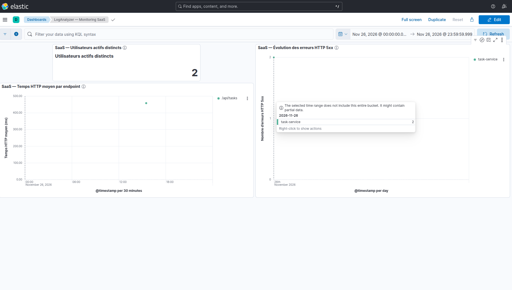
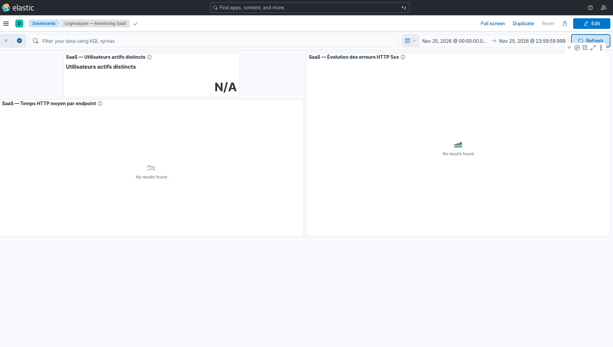

# Dashboard Kibana — Monitoring SaaS

## Objectif et choix des visualisations

SCRUM-26 prévoit trois visualisations complémentaires :
le temps HTTP moyen par endpoint mesure les performances ;
l’évolution des erreurs HTTP 5xx permet de repérer les incidents serveur ;
les utilisateurs actifs distincts mesurent l’activité des utilisateurs.

Ces visualisations sont réunies dans « LogAnalyzer — Monitoring SaaS ».
Chaque panneau conserve son filtre métier et utilise le filtre temporel
global du dashboard.

## Vue de données

- Version utilisée : Elasticsearch et Kibana 8.19.0.
- Motif d’index : `loganalyzer-logs-*`.
- Champ temporel : `@timestamp`.
- Identifiant de la vue : `481f6f41-4248-4e22-8304-31215a19572b`.
- Identifiant du dashboard : `9c0891b8-e4be-4eef-96e1-1c2c89af4c58`.

Les contrôles de référence utilisent le fuseau `Africa/Tunis`.
Pour les reproduire, sélectionner ce fuseau dans le réglage Kibana
`dateFormat:tz`, ou vérifier que le fuseau du navigateur correspond.

## Temps HTTP moyen par endpoint

Type : courbe temporelle, avec une série par `url.path` (Top 10).
L’axe horizontal utilise un histogramme de dates sur `@timestamp`.

Filtre KQL :

```text
event.dataset : "saas.http" and event.duration >= 0 and url.path : *
```

Formule Lens :

```text
average(event.duration) / 1000000
```

`event.duration` est stocké en nanosecondes.
La division par un million donne des millisecondes.
Le libellé est « Temps HTTP moyen (ms) », avec deux décimales.

Chaque point représente la moyenne des requêtes de son intervalle,
pour l’endpoint concerné. Une valeur élevée indique un ralentissement.
La moyenne globale d’une journée doit être calculée sur les requêtes,
sans faire une moyenne non pondérée des moyennes des intervalles.

Les intervalles vides sont inclus, les valeurs manquantes sont masquées
et les points sont visibles. Deux mesures éloignées ne sont donc pas
reliées à travers une période sans données.

## Évolution des erreurs HTTP 5xx

Type : aire empilée, ventilée par `service.name` (Top 10).
L’axe horizontal utilise `@timestamp`, avec un intervalle minimal d’un jour.
L’axe vertical compte les documents, sans décimales.

Filtre KQL :

```text
event.dataset : "saas.http" and http.response.status_code >= 500 and http.response.status_code <= 599
```

Le graphique compte les réponses HTTP de statut 500 à 599.
Il ne représente ni un pourcentage ni tous les logs de niveau ERROR.
Un pic permet de repérer un jour et un service touchés par des erreurs serveur.

Un zéro signifie qu’aucun document ne correspond au filtre dans l’intervalle.
Il ne prouve pas à lui seul que la collecte des logs fonctionne.

## Utilisateurs actifs distincts

Type : métrique. Fonction : `Unique count` sur `user.id`.
Affichage entier, sans ventilation.

Filtre KQL :

```text
event.dataset : ("saas.http" or "saas.business") and user.id : * and not user.id : ""
```

L’indicateur compte les identifiants distincts présents dans les événements
HTTP ou métier de la période sélectionnée. Il ne mesure pas les connexions
simultanées. Un même utilisateur présent plusieurs fois est compté une fois.

Le décompte distinct de Kibana repose sur une agrégation de cardinalité
pouvant être approximative, contrairement au compteur exact de notre API.
Sur le petit jeu de référence, le résultat Kibana concorde avec le calcul exact.

Sur la journée vide testée, Kibana affiche `N/A`, tandis que le calcul
exact retourne zéro identifiant. Ce rendu est documenté comme une absence
de résultat dans la visualisation.

## Validation sur les données de référence

Le calcul de contrôle a extrait tous les documents des journées testées
depuis Elasticsearch dans Docker. Il a vérifié l’absence de timeout,
d’échec de shard et de troncature des résultats.
Le nombre d’utilisateurs a été calculé avec un ensemble Python exact.

Les bornes utilisées sont à début inclus et fin exclue, en heure de Tunis :

- 26 novembre : `[2026-11-26T00:00:00+01:00, 2026-11-27T00:00:00+01:00)`.
- 25 novembre : `[2026-11-25T00:00:00+01:00, 2026-11-26T00:00:00+01:00)`.

| Contrôle | 26 novembre 2026 | 25 novembre 2026 |
|---|---|---|
| Documents extraits | 7 | 0 |
| Durées HTTP de /api/tasks | 125, 500 et 750 ms | Aucune |
| Moyenne HTTP de référence | 458,333333… ms | Non définie |
| Erreurs HTTP 5xx | 2 pour task-service | 0 |
| Utilisateurs distincts exacts | 2 | 0 |
| Rendu des graphiques Kibana | Mesure HTTP et 2 erreurs | No results found |
| Carte utilisateurs Kibana | 2 | N/A |

Le passage du 26 au 25 novembre modifie les trois panneaux :
le filtre temporel global fonctionne sur ces deux cas.

[Bilan du calcul de référence](validation-kibana/reference.json)

### Journée avec données



### Journée sans données



## Export versionné et restauration

L’export se trouve dans
[`loganalyzer-saas-dashboard.ndjson`](../kibana/exports/loganalyzer-saas-dashboard.ndjson).

Son contenu a été contrôlé : une vue de données, trois visualisations Lens
et un dashboard, soit cinq objets, sans référence manquante.
Le fichier est conservé dans son format NDJSON d’origine.

L’export contient les objets Kibana, pas les logs Elasticsearch.
Les index et leurs données doivent être disponibles séparément.

Pour restaurer le dashboard :

1. Utiliser Kibana 8.19.0 pour reproduire l’environnement validé.
2. Ouvrir « Stack Management → Saved Objects → Import ».
3. Sélectionner le fichier NDJSON versionné.
4. Dans un espace vide, importer les cinq objets avec leurs identifiants.
5. Ouvrir « Dashboards → LogAnalyzer — Monitoring SaaS ».
6. Régler le fuseau et la période, puis vérifier les trois panneaux.

Pour réexporter, sélectionner le dashboard dans « Saved Objects »,
cliquer sur « Export » et conserver « Include related objects » activé.

Le contrôle du contenu exporté est réalisé.
La restauration a été testée dans l’espace séparé
« Validation SCRUM-26 » (`validation-scrum-26`).
Le dashboard restauré affiche les trois panneaux sur le 26 novembre 2026 :
2 utilisateurs distincts, 2 erreurs HTTP 5xx pour task-service
et un point de temps HTTP moyen cohérent avec la référence de 458,33 ms.

## Limites de lecture

- Les données de démonstration sont peu nombreuses et espacées.
- Les séries par endpoint et service sont limitées aux Top 10.
- Les résultats dépendent de la période et des filtres sélectionnés.
- Le nombre d’erreurs 5xx n’est pas le taux d’erreurs 5xx.
- Le décompte distinct Kibana peut être approximatif.
- Une période sans logs ne prouve pas une absence réelle d’activité.

## Références

- [Gestion des objets Kibana 8.19](https://www.elastic.co/guide/en/kibana/8.19/managing-saved-objects.html)
- [Agrégation de cardinalité Elasticsearch](https://www.elastic.co/docs/reference/aggregations/search-aggregations-metrics-cardinality-aggregation)
