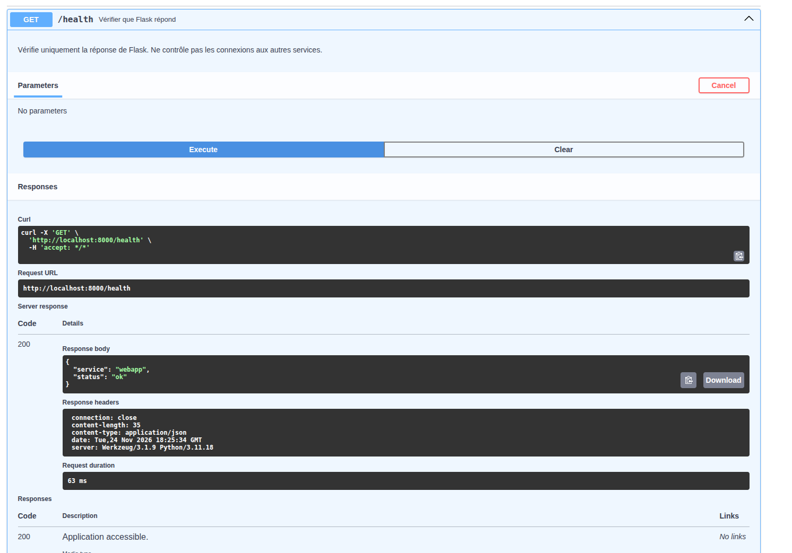
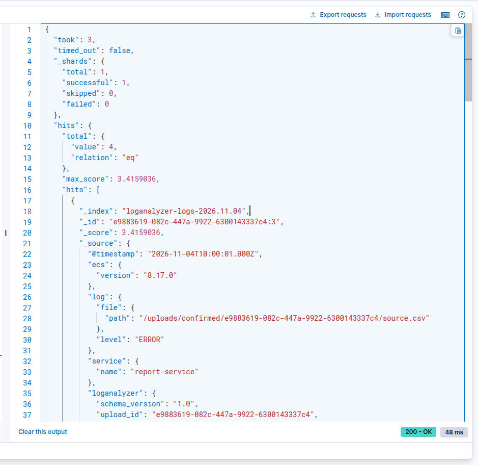
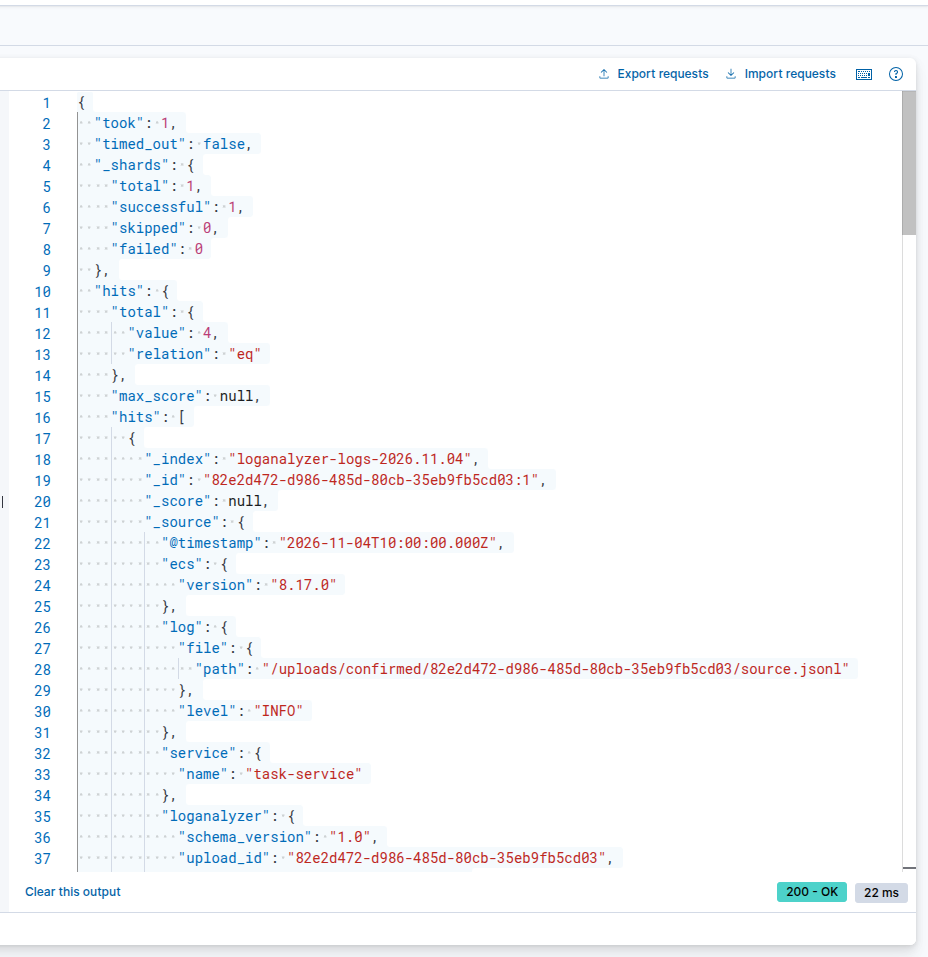
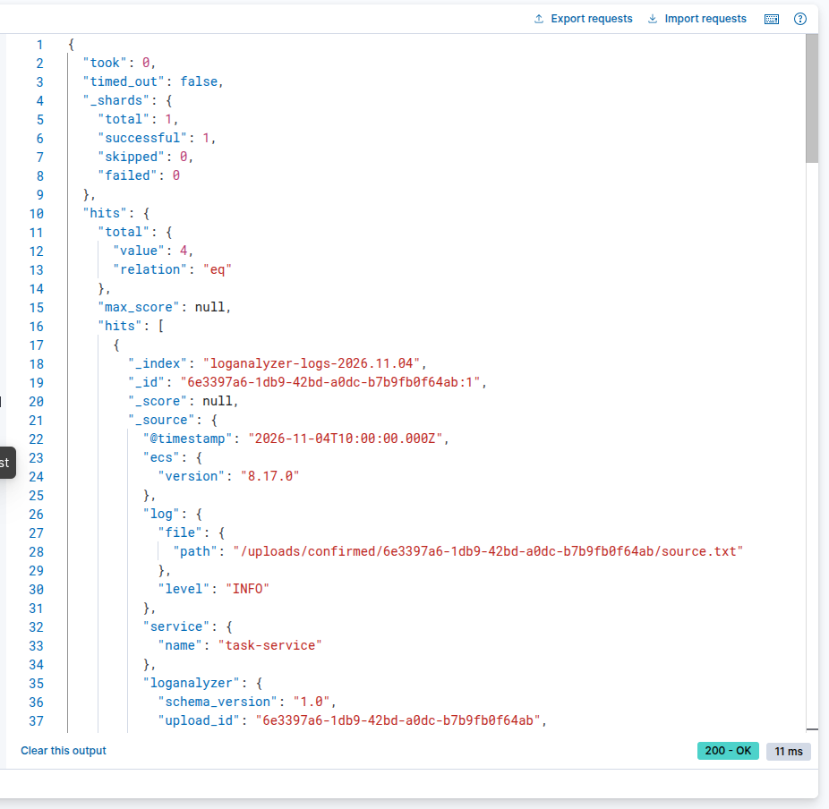
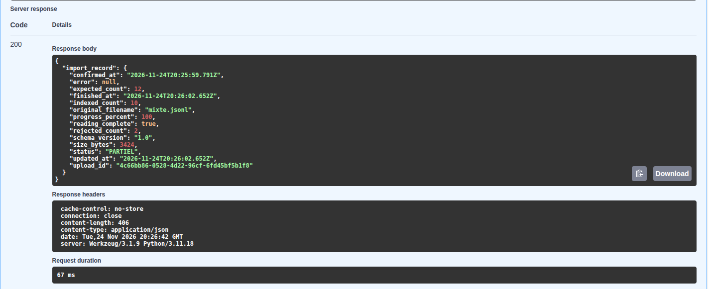
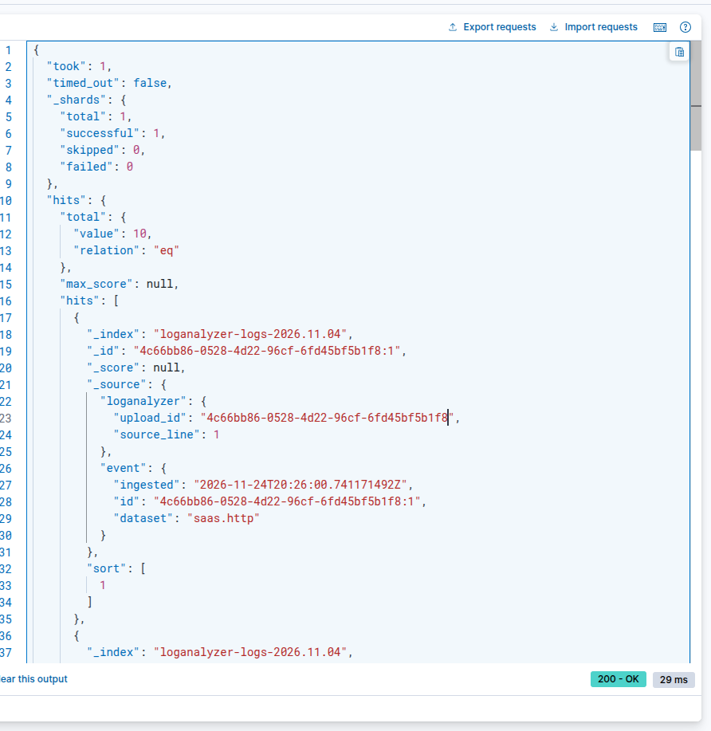

# Rapport technique — LogAnalyzer

## 1. Chaîne d’ingestion des logs

### Objectif

La chaîne permet d’importer des fichiers CSV, JSON Lines et TXT,
de contrôler leurs événements et de rendre les logs valides
disponibles dans Elasticsearch.

L’utilisateur peut suivre l’avancement de son import et consulter
les lignes rejetées avec leurs motifs.

### Déroulement du traitement

1. Flask reçoit le fichier et vérifie son format, sa taille et
   les événements présentés dans la prévisualisation.
2. Après confirmation, le fichier original est conservé dans
   le volume uploads. MongoDB enregistre les métadonnées de
   l’import avec l’état EN_ATTENTE.
3. Le tracker prend en charge l’import et passe son état à EN_COURS.
   Il lit les lignes et les transmet à Logstash par HTTP,
   avec leur format et leurs informations de provenance.
4. Le pipeline Logstash commun aux trois formats réalise le parsing,
   la validation et la normalisation vers ECS.
5. Les événements valides sont indexés dans Elasticsearch.
   Le pipeline final ajoute event.ingested.
6. Les événements invalides sont conservés dans le fichier de rejets
   avec leur contenu original, leur numéro de ligne et leurs motifs.
7. Le tracker vérifie les documents réellement indexés et les rejets
   enregistrés. Il actualise les compteurs et les diagnostics
   dans MongoDB.
8. L’interface Flask affiche l’état, la progression et les rejets.
   Les documents indexés peuvent être consultés dans Kibana.

Le parsing dépend du format d’entrée. La validation et la
normalisation sont communes aux trois formats.

### Règles de finalisation

La fin de lecture du fichier ne suffit pas à déclarer l’import terminé.
Le tracker attend les résultats réels du traitement.

Pour un traitement entièrement résolu :

    événements attendus = événements indexés + événements rejetés

Les états finaux sont :

- TERMINE : tous les événements sont indexés.
- PARTIEL : certains événements sont indexés et d’autres sont rejetés.
- ECHEC : une erreur technique empêche la finalisation, aucun événement
  n’est exploitable ou tous les événements sont rejetés.

Une erreur technique reste distincte d’un rejet de données.
Les compteurs déjà constatés sont conservés en cas d’échec.

### Méthode de validation

Le script checks/validate_ingestion.py teste le parcours depuis
l’upload par l’API Flask jusqu’aux résultats du traitement.

Les contrôles portent notamment sur :

- La prévisualisation et la confirmation de l’import.
- La confirmation répétée du même import.
- Les états et les compteurs exposés par l’API.
- La cohérence avec les informations enregistrées dans MongoDB.
- La conservation du fichier original.
- Les documents réellement retrouvés dans Elasticsearch.
- La conformité des documents valides aux cibles de référence.
- Les identifiants des événements et la présence de event.ingested.
- Les lignes rejetées, leurs motifs et leur contenu original.

Les résultats attendus proviennent de samples/attendus.json
et des documents présents dans samples/cibles/.

### Résultats des douze scénarios

Validation réalisée le 18 novembre 2026.

| Scénario | Résultat constaté |
|---|---|
| CSV valide | TERMINE : 4 attendus, 4 indexés, 0 rejeté |
| JSON Lines valide | TERMINE : 4 attendus, 4 indexés, 0 rejeté |
| TXT valide | TERMINE : 4 attendus, 4 indexés, 0 rejeté |
| CSV avec erreurs sémantiques | Refus à la prévisualisation, diagnostics attendus |
| JSON Lines avec erreurs sémantiques | Refus à la prévisualisation, diagnostics attendus |
| TXT avec erreurs sémantiques | Refus à la prévisualisation, diagnostics attendus |
| JSON mal formé | Refus avec JSON_SYNTAX |
| JSON avec clé dupliquée | Refus avec JSON_DUPLICATE_KEY |
| JSON avec type incorrect | Refus avec INVALID_TYPE |
| CSV avec en-tête incorrect | Refus avec CSV_HEADER |
| TXT avec colonnes manquantes | Refus avec ROW_STRUCTURE |
| JSON Lines mixte | PARTIEL : 12 attendus, 10 indexés, 2 rejetés |

Bilan : **12 scénarios réussis, aucun scénario en échec**.

Les quatre imports confirmés représentent 24 événements :
22 documents indexés et 2 événements rejetés.

Les fichiers refusés à la prévisualisation ne sont pas confirmés
et ne sont pas transmis au traitement.

Résultats détaillés :
[bilan des douze scénarios](validation-ingestion/bilan-20261118T105637Z-a9564dca.json).

### Consultation des rejets dans l’interface

Le fichier mixte contient dix événements valides, puis deux événements
invalides aux lignes 11 et 12.

La ligne 11 ne contient pas le champ obligatoire service.
La ligne 12 contient une date sans fuseau conforme au contrat.

L’interface affiche l’état PARTIEL, les compteurs et les diagnostics.
Elle permet également de consulter le contenu original de chaque rejet.

La capture suivante illustre cette fonctionnalité, vérifiée
lors de SCRUM-17.

### Test d’une erreur de traitement HTTP

Le script checks/validate_processing_error.py vérifie le comportement
du tracker lorsqu’un serveur de test répond HTTP 503 pendant l’envoi.

Le scénario utilise une base MongoDB de test et un serveur HTTP contrôlé.
Il ne nécessite pas d’arrêter le service Logstash du projet.

Résultats constatés :

- La première ligne atteint le serveur de test.
- La réponse HTTP 503 produit l’état ECHEC.
- Le code LOGSTASH_HTTP et le motif HTTP 503 sont enregistrés.
- Le bilan conserve 4 événements attendus, 0 indexé et 0 rejet de données.
- Aucun document Elasticsearch ni faux rejet n’est retrouvé pour cet import.
- Les fichiers temporaires et la base MongoDB de test sont supprimés.

Les quatre événements attendus ne sont pas comptés comme rejetés :
le traitement a été interrompu par une erreur technique.

Le scénario de test est réussi car le comportement observé
correspond au comportement attendu en cas d’erreur.

Résultats détaillés :
[bilan de l’erreur de traitement](validation-ingestion/erreur-traitement-20261118T111950Z-9b797490.json).

### Limites connues

- Les jeux de référence valident le fonctionnement sur de petits fichiers.
  Ils ne constituent pas un test de charge.
- Le test HTTP 503 utilise un serveur contrôlé. Il ne couvre pas
  toutes les pannes possibles des services Docker.
- La progression est actualisée périodiquement. Un délai peut exister
  entre l’indexation et son affichage dans l’interface.
- Après une erreur technique, les compteurs représentent les résultats
  constatés au moment de la finalisation. Des écritures déjà en cours
  peuvent se terminer ensuite.
- Les imports EN_COURS peuvent être repris par le tracker.
  Les imports ECHEC ne sont pas relancés automatiquement.
- La limite du fichier importé est de 100 Mio par défaut.
  La limite HTTP de Logstash est de 1 Mio par requête,
  enveloppe et ligne comprises.

### Documentation complémentaire

- [Formats d’import](formats-import.md)
- [Ingestion et normalisation](ingestion.md)
- [Suivi des imports](suivi-imports.md)

## 2. Documentation de l’API et essais avec Swagger

### Intégration

Swagger UI est accessible à l’adresse http://localhost:8000/api/docs.
La description OpenAPI 3.0.3 est fournie par /api/openapi.json.

Le fichier app/api_docs.py construit cette description. Il est raccordé
à Flask depuis app/main.py et copié dans l’image Docker de l’application.

Aucune dépendance Python supplémentaire n’a été ajoutée.
Les fichiers JavaScript et CSS de Swagger UI sont chargés depuis
jsDelivr ; leur chargement nécessite un accès Internet.

Lors des essais d’ingestion décrits ici, la documentation couvrait six routes : santé de Flask, prévisualisation,
confirmation, annulation d’un brouillon, suivi et consultation des rejets.

### Méthode

Les essais ont été réalisés manuellement le 24 novembre 2026
avec les fichiers de référence de samples/.

Swagger a servi à envoyer les requêtes et à consulter les réponses
réelles de l’API Flask. Les documents indexés ont ensuite été recherchés
dans Elasticsearch depuis la console Dev Tools de Kibana, en filtrant
sur l’identifiant de chaque import.

Les exemples affichés dans la documentation Swagger sont distincts
des réponses réellement obtenues dans Server response.

Le contrôle GET /health a renvoyé HTTP 200 avec status égal à ok.
Il vérifie que Flask répond, sans contrôler les autres services.

### Fichiers valides

Les fichiers CSV, JSONL et TXT valides ont été prévisualisés,
confirmés et traités jusqu’à l’état TERMINE.

| Format | Attendus | Indexés | Rejetés | État final |
|---|---:|---:|---:|---|
| CSV | 4 | 4 | 0 | TERMINE |
| JSONL | 4 | 4 | 0 | TERMINE |
| TXT | 4 | 4 | 0 | TERMINE |

Les recherches Elasticsearch ont retrouvé quatre documents par import.
Les contrôles ont porté sur les identifiants, la provenance,
les champs normalisés et la présence de event.ingested.

Les résultats détaillés du suivi sont conservés ici :

- [Suivi CSV](validation-ingestion/swagger/swagger-csv-valide-suivi.json)
- [Suivi JSONL](validation-ingestion/swagger/swagger-jsonl-valide-suivi.json)
- [Suivi TXT](validation-ingestion/swagger/swagger-txt-valide-suivi.json)

Les réponses finales ont été récupérées depuis les routes de suivi
de la même API afin de conserver les bilans des imports essayés
dans Swagger. Cette récupération ne relance pas leur traitement.

### Fichier mixte

Le fichier mixte.jsonl contient douze événements.
Les dix premiers sont valides et permettent la confirmation de l’aperçu.
Les lignes 11 et 12 sont rejetées pendant le traitement Logstash.

Le résultat observé est PARTIEL : 12 attendus, 10 indexés et 2 rejetés.
La progression atteint 100 %, car les douze événements ont un résultat.

La consultation des rejets renvoie :

- Ligne 11 : REQUIRED_FIELD sur service.
- Ligne 12 : INVALID_TIMESTAMP sur timestamp.
- Le contenu original de chaque ligne dans raw.

La recherche Elasticsearch retrouve uniquement les lignes 1 à 10,
avec des identifiants conformes et event.ingested renseigné.
Les lignes 11 et 12 sont absentes des documents indexés.

- [Suivi du fichier mixte](validation-ingestion/swagger/swagger-mixte-suivi.json)
- [Diagnostics des deux rejets](validation-ingestion/swagger/swagger-mixte-rejets.json)

### Fichiers invalides dès la prévisualisation

Les trois fichiers contenant des erreurs de données renvoient
can_confirm égal à false, sans identifiant permettant la confirmation.

Les diagnostics attendus sont retrouvés : champ obligatoire absent,
date incorrecte, niveau non autorisé, statut HTTP hors limites,
durée invalide et champ interdit pour la famille.

Les erreurs concernent les lignes 2 à 7 du CSV et les lignes 1 à 6
des fichiers JSONL et TXT.

- [CSV invalide](validation-ingestion/swagger/swagger-csv-invalide-preview.json)
- [JSONL invalide](validation-ingestion/swagger/swagger-jsonl-invalide-preview.json)
- [TXT invalide](validation-ingestion/swagger/swagger-txt-invalide-preview.json)

Cinq fichiers supplémentaires vérifient les erreurs de structure
et de type :

| Fichier | Diagnostic constaté |
|---|---|
| json-malforme.jsonl | JSON_SYNTAX |
| json-cle-dupliquee.jsonl | JSON_DUPLICATE_KEY |
| json-type-incorrect.jsonl | INVALID_TYPE sur status_code |
| csv-entete-incorrect.csv | CSV_HEADER |
| txt-colonnes-manquantes.txt | ROW_STRUCTURE : 18 colonnes attendues, 2 reçues |

- [JSON mal formé](validation-ingestion/swagger/swagger-json-malforme-preview.json)
- [Clé JSON dupliquée](validation-ingestion/swagger/swagger-json-cle-dupliquee-preview.json)
- [Type JSON incorrect](validation-ingestion/swagger/swagger-json-type-incorrect-preview.json)
- [En-tête CSV incorrect](validation-ingestion/swagger/swagger-csv-entete-incorrect-preview.json)
- [Colonnes TXT manquantes](validation-ingestion/swagger/swagger-txt-colonnes-manquantes-preview.json)

Ces fichiers sont bloqués par Flask avant confirmation.
Ils ne sont pas transmis à Logstash. Les JSON téléchargés conservent
les corps des réponses, mais pas les codes HTTP ni leurs en-têtes.

### Bilan et portée

Les douze scénarios d’ingestion ont été rejoués manuellement :
trois fichiers valides, trois fichiers avec erreurs de données,
cinq fichiers avec erreurs de structure ou de type et un fichier mixte.

Pour les quatre imports confirmés retenus dans ce bilan,
24 événements sont attendus : 22 sont indexés et 2 sont rejetés.

Le scénario technique HTTP 503 reste documenté dans la première
section à partir du test automatisé. Il n’a pas été rejoué avec Swagger.

Swagger facilite la documentation et les appels manuels de l’API.
Il ne remplace pas les scripts qui comparent automatiquement
les résultats aux références et ne rédige pas le rapport.

## 3. Recherche, détail et export

La recherche interroge les logs Elasticsearch avec des filtres
de texte, niveau, service, dates et identifiant d’import.
Les résultats indiquent le total, proposent le tri et une pagination
de 50 logs par page.

Le détail présente les champs et le document JSON dans une popup.
L’export CSV reprend les filtres sur toutes les pages, dans la limite
de 10 000 logs et 20 Mio. Il relit les données au moment de l’export.

Les dates de recherche sont inclusives aux deux bornes.
Cette convention diffère de celle des indicateurs, à fin exclue.

Références : [recherche](recherche.md), [détail et export](detail-export.md).

## 4. Fichiers importés et historique

La liste des fichiers exploite les métadonnées MongoDB.
Elle propose le tri, la pagination et les filtres.
La sélection d’un fichier active les actions de suivi et de recherche
de ses logs.

L’historique MongoDB conserve les critères, la date et le nombre
de résultats d’une recherche. La relance réexécute les critères ;
elle ne restitue pas un instantané des anciens résultats.
Sans authentification, cet historique est commun à l’application.

Références : [fichiers](fichiers.md),
[historique](historique-recherches.md),
[schéma MongoDB](schema-historique-recherches.md).

## 5. Indicateurs du tableau de bord

Les quatre cartes présentent le total des logs, les logs du jour
dans Africa/Tunis, les logs ERROR/CRITICAL de la période
et le nombre global d’imports confirmés.

Les indicateurs SaaS couvrent les moyennes HTTP en millisecondes,
les taux HTTP 5xx, les exécutions SQL lentes, les utilisateurs distincts
et l’utilisation des fonctionnalités.
Leurs populations, filtres et bornes sont documentés séparément.

Le nombre d’utilisateurs distincts ne mesure pas des connexions
simultanées. Les logs ERROR/CRITICAL ne sont pas équivalents
aux réponses HTTP 5xx.

Références : [dashboard](dashboard.md), [formules](formules-kpi.md).

## 6. Cache Redis

Redis met en cache les résultats des indicateurs pendant une durée
configurable, de 60 secondes par défaut.
Les contrôles existants couvrent notamment les réponses MISS/HIT,
l’expiration et le comportement lorsque le cache est indisponible.

Une réponse en cache peut précéder un import récent.
La date du calcul permet de situer la fraîcheur des résultats.
Le projet ne revendique pas une invalidation immédiate après import.

Références : [cache](cache-redis.md),
[bilan de validation](validation-cache/bilan-cache.json).

## 7. Interface et intégration Kibana

L’interface comporte six écrans avec navigation adaptée aux petits écrans.
Les détails sont consultés dans des popups avec fermeture au bouton
ou avec Échap. Les transitions respectent la réduction des mouvements.

Swagger est accessible dans l’en-tête du tableau de bord et s’ouvre
dans un nouvel onglet. Le menu principal donne accès à Kibana.

Le dashboard Kibana regroupe trois visualisations : temps HTTP moyen
par route, évolution des erreurs HTTP 5xx et utilisateurs distincts.
Il utilise les données indexées dans Elasticsearch.
Son sélecteur temporel est indépendant des filtres Flask.

Le dashboard, les trois visualisations et la vue de données sont exportés
en NDJSON. La restauration a été vérifiée dans un espace séparé.
L’intégration iframe a également été confirmée dans l’application.

Les contrôles de disponibilité surveillent six services.
Ils ne garantissent ni une ingestion complète ni l’affichage d’une iframe.
Le rafraîchissement du contrôle ne signifie pas celui des graphiques.

Références : [guide illustré](guide-utilisateur.md),
[Kibana et résultats de référence](kibana.md).

## 8. Revue du socle et résultats récents

SCRUM-27 relie les exigences, les fonctionnalités et les preuves.
Les validations antérieures sont conservées et distinguées des
contrôles réexécutés pendant la revue.

La revalidation automatisée de l’ingestion du 27 novembre a obtenu
12 scénarios réussis, zéro échec.
Le scénario HTTP 503 contrôlé a également réussi :
4 événements attendus, zéro indexé et zéro faux rejet de données.
Ses fichiers temporaires et sa base MongoDB de test ont été supprimés.

Le validateur historique a dû être actualisé pour vérifier les champs
dérivés search_text et search_values, ajoutés pour la recherche générale.
Les essais initiaux en échec restent conservés avec le nouveau bilan.

Les validations sur petits jeux ne constituent pas des tests de charge.
La revue globale reste en cours ; ces résultats ne suffisent pas
à déclarer chaque exigence de l’énoncé conforme.

Bilans récents :

- [Douze scénarios](validation-socle/bilan-20261127T195849Z-ee489653.json)
- [Erreur HTTP 503](validation-socle/erreur-traitement-20261127T200034Z-966d463a.json)

Documents de synthèse :

- [Matrice de couverture](validation-socle.md)
- [Parcours de démonstration](parcours-demonstration.md)
- [Défauts, écarts et priorités](defauts-socle.md)
