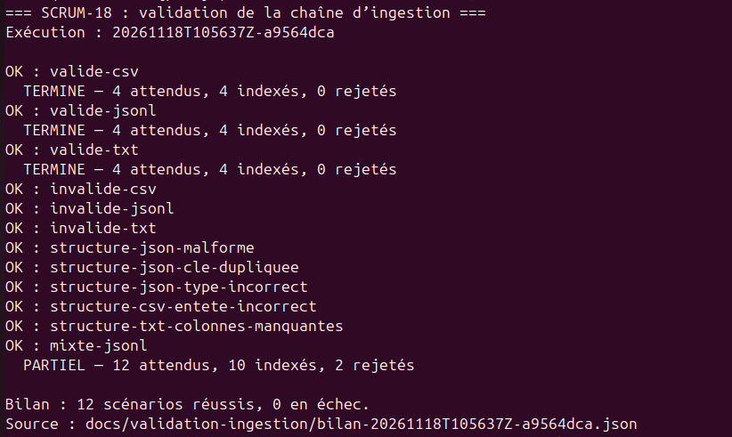
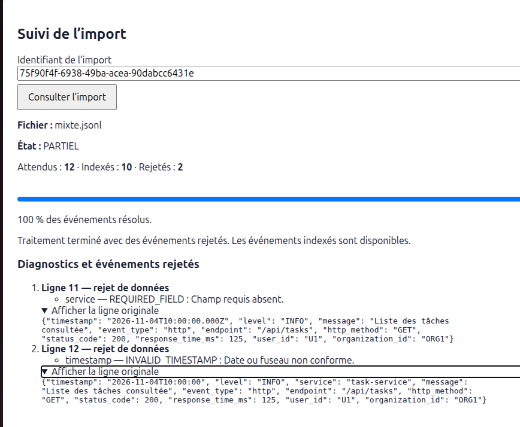
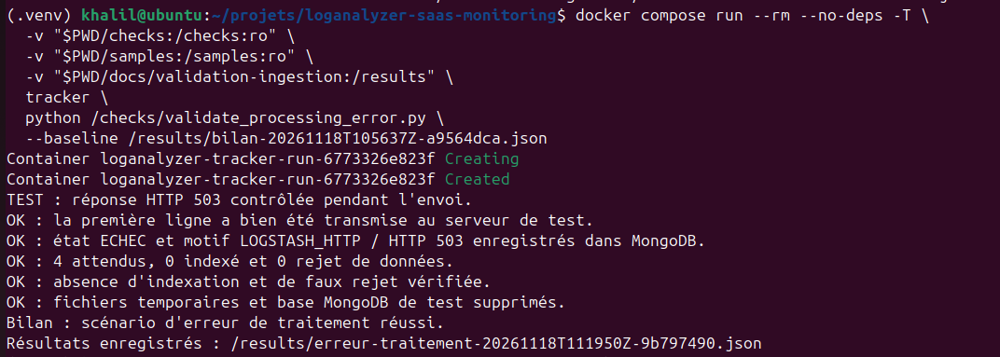

# Rapport technique — LogAnalyzer

## 1. Chaîne d’ingestion des logs

### Objectif

La chaîne permet d’importer des fichiers CSV, JSON Lines et TXT,
de contrôler leurs événements et de rendre les logs valides
disponibles dans Elasticsearch.

L’utilisateur peut suivre l’avancement de son import et consulter
les lignes rejetées avec leurs motifs.

### Déroulement du traitement

1. Flask reçoit le fichier et vérifie son format, sa taille et
   les événements présentés dans la prévisualisation.
2. Après confirmation, le fichier original est conservé dans
   le volume uploads. MongoDB enregistre les métadonnées de
   l’import avec l’état EN_ATTENTE.
3. Le tracker prend en charge l’import et passe son état à EN_COURS.
   Il lit les lignes et les transmet à Logstash par HTTP,
   avec leur format et leurs informations de provenance.
4. Le pipeline Logstash commun aux trois formats réalise le parsing,
   la validation et la normalisation vers ECS.
5. Les événements valides sont indexés dans Elasticsearch.
   Le pipeline final ajoute event.ingested.
6. Les événements invalides sont conservés dans le fichier de rejets
   avec leur contenu original, leur numéro de ligne et leurs motifs.
7. Le tracker vérifie les documents réellement indexés et les rejets
   enregistrés. Il actualise les compteurs et les diagnostics
   dans MongoDB.
8. L’interface Flask affiche l’état, la progression et les rejets.
   Les documents indexés peuvent être consultés dans Kibana.

Le parsing dépend du format d’entrée. La validation et la
normalisation sont communes aux trois formats.

### Règles de finalisation

La fin de lecture du fichier ne suffit pas à déclarer l’import terminé.
Le tracker attend les résultats réels du traitement.

Pour un traitement entièrement résolu :

    événements attendus = événements indexés + événements rejetés

Les états finaux sont :

- TERMINE : tous les événements sont indexés.
- PARTIEL : certains événements sont indexés et d’autres sont rejetés.
- ECHEC : une erreur technique empêche la finalisation, aucun événement
  n’est exploitable ou tous les événements sont rejetés.

Une erreur technique reste distincte d’un rejet de données.
Les compteurs déjà constatés sont conservés en cas d’échec.

### Méthode de validation

Le script checks/validate_ingestion.py teste le parcours depuis
l’upload par l’API Flask jusqu’aux résultats du traitement.

Les contrôles portent notamment sur :

- La prévisualisation et la confirmation de l’import.
- La confirmation répétée du même import.
- Les états et les compteurs exposés par l’API.
- La cohérence avec les informations enregistrées dans MongoDB.
- La conservation du fichier original.
- Les documents réellement retrouvés dans Elasticsearch.
- La conformité des documents valides aux cibles de référence.
- Les identifiants des événements et la présence de event.ingested.
- Les lignes rejetées, leurs motifs et leur contenu original.

Les résultats attendus proviennent de samples/attendus.json
et des documents présents dans samples/cibles/.

### Résultats des douze scénarios

Validation réalisée le 18 novembre 2026.

| Scénario | Résultat constaté |
|---|---|
| CSV valide | TERMINE : 4 attendus, 4 indexés, 0 rejeté |
| JSON Lines valide | TERMINE : 4 attendus, 4 indexés, 0 rejeté |
| TXT valide | TERMINE : 4 attendus, 4 indexés, 0 rejeté |
| CSV avec erreurs sémantiques | Refus à la prévisualisation, diagnostics attendus |
| JSON Lines avec erreurs sémantiques | Refus à la prévisualisation, diagnostics attendus |
| TXT avec erreurs sémantiques | Refus à la prévisualisation, diagnostics attendus |
| JSON mal formé | Refus avec JSON_SYNTAX |
| JSON avec clé dupliquée | Refus avec JSON_DUPLICATE_KEY |
| JSON avec type incorrect | Refus avec INVALID_TYPE |
| CSV avec en-tête incorrect | Refus avec CSV_HEADER |
| TXT avec colonnes manquantes | Refus avec ROW_STRUCTURE |
| JSON Lines mixte | PARTIEL : 12 attendus, 10 indexés, 2 rejetés |

Bilan : **12 scénarios réussis, aucun scénario en échec**.

Les quatre imports confirmés représentent 24 événements :
22 documents indexés et 2 événements rejetés.

Les fichiers refusés à la prévisualisation ne sont pas confirmés
et ne sont pas transmis au traitement.

Résultats détaillés :
[bilan des douze scénarios](validation-ingestion/bilan-20261118T105637Z-a9564dca.json).

### Consultation des rejets dans l’interface

Le fichier mixte contient dix événements valides, puis deux événements
invalides aux lignes 11 et 12.

La ligne 11 ne contient pas le champ obligatoire service.
La ligne 12 contient une date sans fuseau conforme au contrat.

L’interface affiche l’état PARTIEL, les compteurs et les diagnostics.
Elle permet également de consulter le contenu original de chaque rejet.

La capture suivante illustre cette fonctionnalité, vérifiée
lors de SCRUM-17.

### Test d’une erreur de traitement HTTP

Le script checks/validate_processing_error.py vérifie le comportement
du tracker lorsqu’un serveur de test répond HTTP 503 pendant l’envoi.

Le scénario utilise une base MongoDB de test et un serveur HTTP contrôlé.
Il ne nécessite pas d’arrêter le service Logstash du projet.

Résultats constatés :

- La première ligne atteint le serveur de test.
- La réponse HTTP 503 produit l’état ECHEC.
- Le code LOGSTASH_HTTP et le motif HTTP 503 sont enregistrés.
- Le bilan conserve 4 événements attendus, 0 indexé et 0 rejet de données.
- Aucun document Elasticsearch ni faux rejet n’est retrouvé pour cet import.
- Les fichiers temporaires et la base MongoDB de test sont supprimés.

Les quatre événements attendus ne sont pas comptés comme rejetés :
le traitement a été interrompu par une erreur technique.

Le scénario de test est réussi car le comportement observé
correspond au comportement attendu en cas d’erreur.

Résultats détaillés :
[bilan de l’erreur de traitement](validation-ingestion/erreur-traitement-20261118T111950Z-9b797490.json).

### Limites connues

- Les jeux de référence valident le fonctionnement sur de petits fichiers.
  Ils ne constituent pas un test de charge.
- Le test HTTP 503 utilise un serveur contrôlé. Il ne couvre pas
  toutes les pannes possibles des services Docker.
- La progression est actualisée périodiquement. Un délai peut exister
  entre l’indexation et son affichage dans l’interface.
- Après une erreur technique, les compteurs représentent les résultats
  constatés au moment de la finalisation. Des écritures déjà en cours
  peuvent se terminer ensuite.
- Les imports EN_COURS peuvent être repris par le tracker.
  Les imports ECHEC ne sont pas relancés automatiquement.
- La limite du fichier importé est de 100 Mio par défaut.
  La limite HTTP de Logstash est de 1 Mio par requête,
  enveloppe et ligne comprises.

### Documentation complémentaire

- [Formats d’import](formats-import.md)
- [Ingestion et normalisation](ingestion.md)
- [Suivi des imports](suivi-imports.md)
