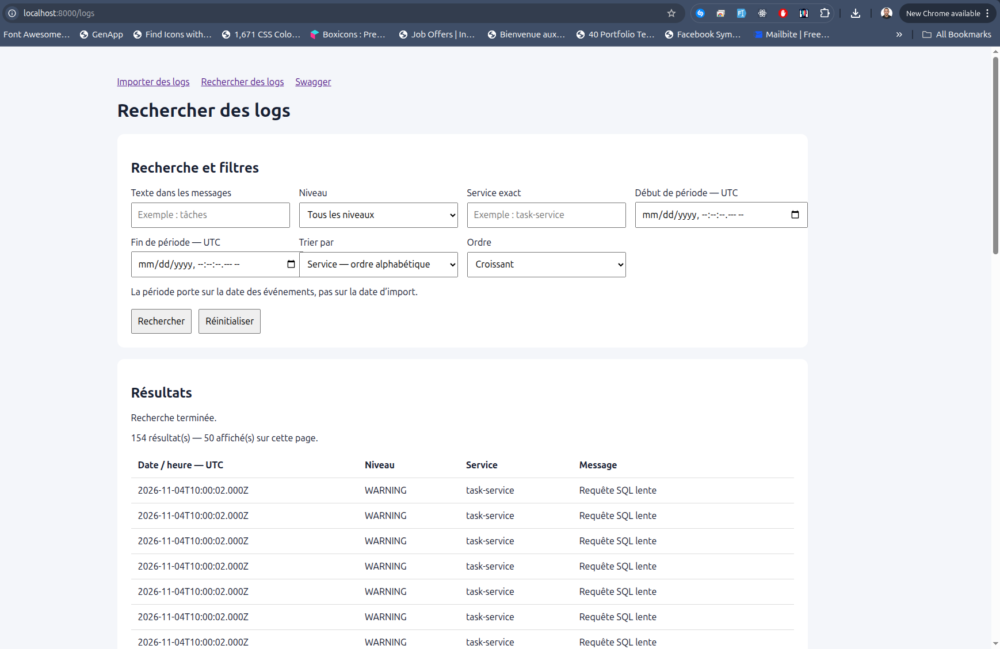
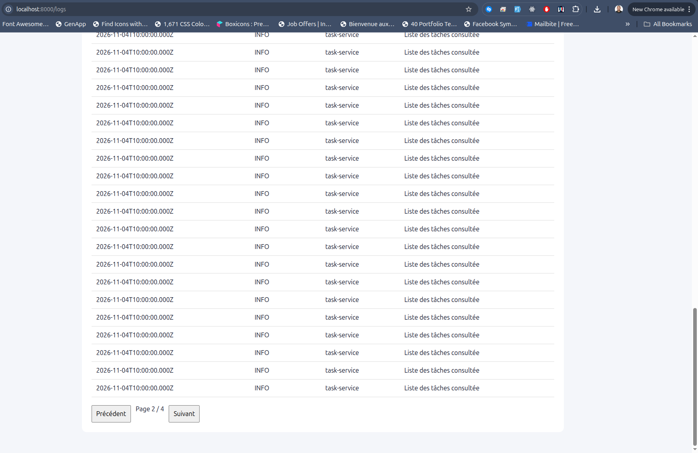
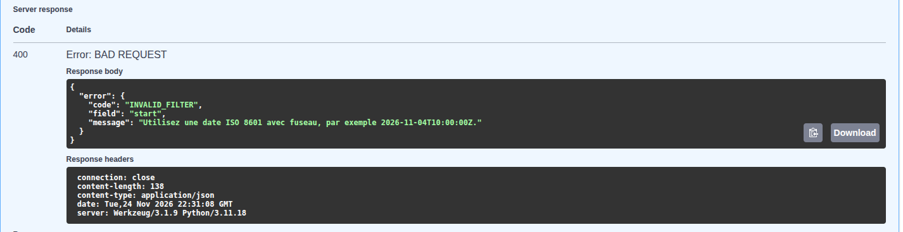

# Recherche et filtres — SCRUM-19

## Fonctionnement

La page `/logs` permet de rechercher les événements indexés dans Elasticsearch.

Le formulaire propose :
- un texte recherché dans `message` et `error.message` ;
- un niveau exact ;
- un service exact ;
- une période portant sur `@timestamp`, la date de l’événement ;
- un tri et son sens.

Les critères renseignés sont combinés. Tous les mots du texte recherché
sont requis. Le texte est analysé par Elasticsearch : il ne s’agit pas
d’une recherche de sous-chaîne exacte.

Les dates du formulaire sont saisies en UTC. Les bornes de période sont inclusives.

Le tableau affiche la date, le niveau, le service et le message.
Le nombre total de résultats et le nombre de lignes affichées sont indiqués.
Les boutons Précédent et Suivant conservent les critères de la recherche.

## API

### GET /api/v1/logs

La route interroge les index `loganalyzer-logs-*`.

| Paramètre | Description | Valeur par défaut |
|---|---|---|
| `q` | Texte recherché, 500 caractères maximum | Vide |
| `level` | DEBUG, INFO, WARNING, ERROR ou CRITICAL | Tous |
| `service` | Nom exact du service | Tous |
| `start` | Début inclusif en ISO 8601 avec fuseau | Aucune borne |
| `end` | Fin inclusive en ISO 8601 avec fuseau | Aucune borne |
| `sort` | `date`, `level` ou `service` | `date` |
| `order` | `asc` ou `desc` | `desc` |
| `page` | Numéro de page, de 1 à 200 | 1 |

Les dates acceptent jusqu’à trois chiffres de fractions de seconde.
Elles sont normalisées en UTC.

Les champs Elasticsearch utilisés sont :
- texte : `message` et `error.message` ;
- niveau : `log.level` ;
- service : `service.name` ;
- date : `@timestamp`.

Le tri par niveau et par service est alphabétique.
Le tri par niveau ne représente pas un ordre de gravité.
Pour ces deux tris, la date décroissante départage les valeurs identiques.
L’identifiant `event.id` sert de dernier critère de tri.

### Réponses

| HTTP | Signification |
|---|---|
| 200 | Recherche exécutée, avec ou sans résultat |
| 400 | Paramètre invalide, inconnu ou répété |
| 503 | Elasticsearch indisponible ou réponse de recherche incomplète |

Une réponse réussie contient :
- `items` : documents de la page, accompagnés de leur identifiant et de leur index ;
- `total` : nombre exact de résultats correspondant aux critères ;
- `page` et `page_size` ;
- `total_pages` et `accessible_pages` ;
- `has_previous` et `has_next` ;
- `pagination_limited` ;
- `filters` : critères appliqués.

Chaque page contient au maximum 50 documents.
Une recherche sans correspondance renvoie `total: 0` et `items: []`.

Une page située après la dernière page de résultats, mais dans la plage
autorisée de 1 à 200, renvoie une liste vide et conserve le total de la recherche.

### Documentation interactive

Swagger UI est accessible sur `/api/docs`.
La spécification OpenAPI est publiée sur `/api/openapi.json`.

Dans Swagger, utiliser GET `/api/v1/logs`, puis Try it out et Execute.
La section Server response contient la réponse réelle de l’application.
Les exemples de schéma décrivent le contrat et ne constituent pas des résultats de test.

## Vérifications réalisées le 24 novembre 2026

Les essais utilisent les documents déjà indexés lors des imports précédents.
Le corpus observé contient 154 documents.
Ces nombres peuvent changer après de nouveaux imports.

| Vérification | Résultat observé | Preuve |
|---|---|---|
| Texte « Liste des tâches », niveau INFO et service task-service | 91 résultats, 50 sur la première page | [Réponse](validation-recherche/swagger/Swagger-general-filter-test.json) |
| Période réduite exactement à 2026-11-04T10:00:00Z, avec les mêmes filtres | 91 résultats : bornes inclusives | [Réponse](validation-recherche/swagger/recherche-periode-inclusive.json) |
| Période du 5 novembre, avec les mêmes filtres | 0 résultat et liste vide | [Réponse](validation-recherche/swagger/recherche-periode-vide.json) |
| Fin de période antérieure au début | INVALID_FILTER sur le champ end | [Réponse](validation-recherche/swagger/recherche-periode-invalide.json) |
| Première page de la recherche filtrée | 50 documents | [Réponse](validation-recherche/swagger/recherche-pagination-page-1.json) |
| Deuxième page de la recherche filtrée | 41 documents et aucune page suivante | [Réponse](validation-recherche/swagger/recherche-pagination-page-2.json) |
| Date croissante, sans filtre | Ordre croissant sur les 50 documents renvoyés | [Réponse](validation-recherche/swagger/recherche-tri-date-asc.json) |
| Date décroissante, sans filtre | Ordre décroissant sur les 50 documents renvoyés | [Réponse](validation-recherche/swagger/recherche-tri-date-desc.json) |
| Niveau croissant, sans filtre | ERROR apparaît avant INFO | [Réponse](validation-recherche/swagger/recherche-tri-niveau-asc.json) |
| Service croissant, sans filtre | report-service apparaît avant task-service | [Réponse](validation-recherche/swagger/recherche-tri-service-asc.json) |

La comparaison des réponses de pagination transmises pendant la validation
a montré 50 documents sur la première page et 41 sur la deuxième :
aucun identifiant commun entre les deux pages, soit 91 documents distincts.

Un appel avec `level=INCONNU` a également renvoyé HTTP 400 et
`INVALID_FILTER` sur `level`, lors de la vérification au terminal.

La navigation Précédent/Suivant et le message d’absence de résultats
ont été vérifiés manuellement dans l’interface.

Les fichiers JSON téléchargés conservent le corps des réponses.
Ils ne conservent pas à eux seuls le code HTTP ni l’URL complète de la requête.

## Limites connues

- La navigation couvre les 10 000 premiers résultats, soit 200 pages.
  Le total reste exact au-delà ; il faut préciser les filtres pour réduire
  la recherche.
- Les pages ne constituent pas un instantané figé. Des imports ou suppressions
  entre deux appels peuvent modifier leur contenu et leur total.
- Les essais de tri enregistrés vérifient les premières pages fournies,
  pas l’ensemble de toutes les pages et de toutes les combinaisons.
- Le traitement HTTP 503 est implémenté, mais aucun essai de panne de recherche
  n’est enregistré dans cette série de preuves.
- La finalisation du design et les vérifications sur plusieurs tailles
  d’écran relèvent de SCRUM-25.

## Captures des vérifications

### Interface et compteur

La recherche générale contient 154 résultats au moment de la capture.
Le tableau affiche 50 documents sur la page consultée.

### Pagination dans l’interface

La capture montre la page 2 sur 4 de la recherche générale,
avec les boutons Précédent et Suivant disponibles.

### Date au format invalide

Swagger affiche une réponse réelle HTTP 400, avec `INVALID_FILTER`
sur `start`. La date de début ne respecte pas le format ISO 8601
avec fuseau attendu.

Ce cas est distinct de la période inversée conservée dans
`validation-recherche/swagger/recherche-periode-invalide.json`,
qui signale une erreur sur `end`.

